# Awesome GPT-6.2 Sol

English · [简体中文](README.zh-CN.md)

[](https://awesome.re) [](#contents) [](docs/prompts.md) [](https://github.com/sandbase-lab/awesome-gpt-6-2-sol/actions/workflows/sync.yml) [](https://www.sandbase.ai/model/openai/gpt-6.2-sol?utm_source=github&utm_medium=readme&utm_campaign=awesome-gpt-6-2-sol)

[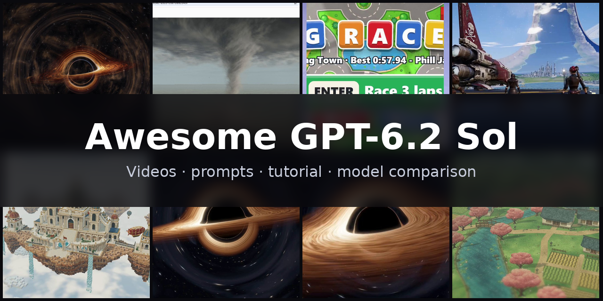](https://www.sandbase.ai/lab/ai-videos/gpt-6-2-sol?utm_source=github&utm_medium=readme&utm_campaign=awesome-gpt-6-2-sol&utm_content=banner)

A curated list of **GPT-6.2 Sol examples**: videos, prompts and demos made with GPT-6.2 Sol, OpenAI's model announced on November 8, 2026. Mostly Three.js 3D scenes and playable pages, plus head-to-head comparisons with other models, each one credited to its creator and linked to the original post.

**32 videos** from **24 creators** · **3** with the creator's prompt · synced daily from [SandBase Lab](https://www.sandbase.ai/lab/ai-videos/gpt-6-2-sol?utm_source=github&utm_medium=readme&utm_campaign=awesome-gpt-6-2-sol&utm_content=stats)

## Start here

| I want to… | Go to |
|---|---|
| Watch the videos | [Browse by category](#contents) below, or [play them full-size on SandBase Lab](https://www.sandbase.ai/lab/ai-videos/gpt-6-2-sol?utm_source=github&utm_medium=readme&utm_campaign=awesome-gpt-6-2-sol&utm_content=quickstart) |
| Copy a prompt | [Prompt index](docs/prompts.md): every video that comes with its prompt |
| Write your own prompt | [Prompt guide](docs/prompt-guide.md): 3 patterns and a fill-in template |
| Make a video | [Tutorial](docs/tutorial.md): prompt → HTML → MP4, with the API and a recording script |
| Pick a model | [GPT-6.2 Sol against the rivals](docs/model-comparison.md): what was measured and what creators reported |
| Try it now | [Run GPT-6.2 Sol in the Lab arena](https://www.sandbase.ai/arena/text?models=openai%2Fgpt-6.2-sol&utm_source=github&utm_medium=readme&utm_campaign=awesome-gpt-6-2-sol&utm_content=quickstart), next to other models |

<a id="contents"></a>

## Contents

- [Featured](#featured) (5)
- [3D scenes](#3d-scene) (19)
- [Motion graphics](#motion-graphics) (1)
- [Games](#game) (3)
- [Tests & comparisons](#comparison) (9)
- [Recreate a video with GPT-6.2 Sol](#recreate)
- [FAQ](#faq)
- [Suggest a video](#contribute)

Click a preview to play the video. Click a title for the post, the prompt and **Recreate** on SandBase Lab. **@handle** links to the creator's post on X.

<a id="featured"></a>

## Featured

<table>
<tr><td width="33%" valign="top"><a href="https://www.sandbase.ai/lab/media/x/gpt-6-2-sol/2119469657291997366/video.mp4">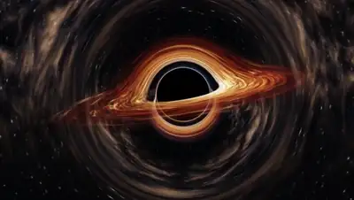</a><br><a href="https://www.sandbase.ai/lab/ai-videos/gpt-6-2-sol/2119469657291997366?utm_source=github&utm_medium=readme&utm_campaign=awesome-gpt-6-2-sol&utm_content=card"><b>Simulation of a black hole with gravitational lensing</b></a><br><sub><a href="https://x.com/pankajkumar_dev/status/2119469657291997366">@pankajkumar_dev</a> · 0:30</sub></td><td width="33%" valign="top"><a href="https://www.sandbase.ai/lab/media/x/gpt-6-2-sol/2119464819229344113/video.mp4"></a><br><a href="https://www.sandbase.ai/lab/ai-videos/gpt-6-2-sol/2119464819229344113?utm_source=github&utm_medium=readme&utm_campaign=awesome-gpt-6-2-sol&utm_content=card"><b>Interactive tornado simulation in Three.js</b></a><br><sub><a href="https://x.com/Cayden970207/status/2119464819229344113">@Cayden970207</a> · 0:33 · <a href="https://www.sandbase.ai/lab/ai-videos/gpt-6-2-sol/2119464819229344113?utm_source=github&utm_medium=readme&utm_campaign=awesome-gpt-6-2-sol&utm_content=card">prompt</a></sub></td><td width="33%" valign="top"><a href="https://www.sandbase.ai/lab/media/x/gpt-6-2-sol/2119495488445497489/video.mp4"></a><br><a href="https://www.sandbase.ai/lab/ai-videos/gpt-6-2-sol/2119495488445497489?utm_source=github&utm_medium=readme&utm_campaign=awesome-gpt-6-2-sol&utm_content=card"><b>Code-generated motion test with animations and glitch effects</b></a><br><sub><a href="https://x.com/BreezeOg1/status/2119495488445497489">@BreezeOg1</a> · 0:23</sub></td></tr>
<tr><td width="33%" valign="top"><a href="https://www.sandbase.ai/lab/media/x/gpt-6-2-sol/2120107337650155798/video.mp4">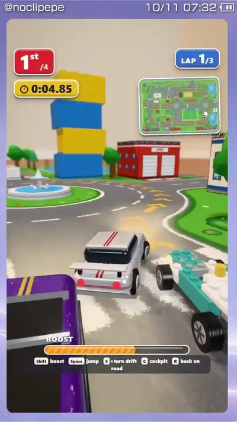</a><br><a href="https://www.sandbase.ai/lab/ai-videos/gpt-6-2-sol/2120107337650155798?utm_source=github&utm_medium=readme&utm_campaign=awesome-gpt-6-2-sol&utm_content=card"><b>Childhood rug turned into a playable game</b></a><br><sub><a href="https://x.com/noclipepe/status/2120107337650155798">@noclipepe</a> · 0:55</sub></td><td width="33%" valign="top"><a href="https://www.sandbase.ai/lab/media/x/gpt-6-2-sol/2119673965576655211/video.mp4">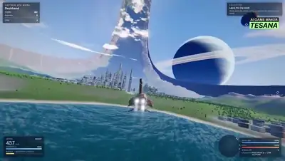</a><br><a href="https://www.sandbase.ai/lab/ai-videos/gpt-6-2-sol/2119673965576655211?utm_source=github&utm_medium=readme&utm_campaign=awesome-gpt-6-2-sol&utm_content=card"><b>A space pirate game created with one prompt</b></a><br><sub><a href="https://x.com/Thomas_jorgen/status/2119673965576655211">@Thomas_jorgen</a> · 1:02</sub></td></tr>
</table>

<a id="3d-scene"></a>

## 3D scenes

<table>
<tr><td width="33%" valign="top"><a href="https://www.sandbase.ai/lab/media/x/gpt-6-2-sol/2119371334878744648/video.mp4">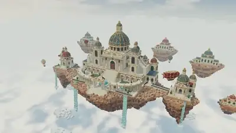</a><br><a href="https://www.sandbase.ai/lab/ai-videos/gpt-6-2-sol/2119371334878744648?utm_source=github&utm_medium=readme&utm_campaign=awesome-gpt-6-2-sol&utm_content=card"><b>Three.js scenes generated from a single prompt</b></a><br><sub><a href="https://x.com/TokenGremlin/status/2119371334878744648">@TokenGremlin</a> · 0:05</sub></td><td width="33%" valign="top"><a href="https://www.sandbase.ai/lab/media/x/gpt-6-2-sol/2119395930805879165/video.mp4"></a><br><a href="https://www.sandbase.ai/lab/ai-videos/gpt-6-2-sol/2119395930805879165?utm_source=github&utm_medium=readme&utm_campaign=awesome-gpt-6-2-sol&utm_content=card"><b>A black hole created with Three.js</b></a><br><sub><a href="https://x.com/TokenGremlin/status/2119395930805879165">@TokenGremlin</a> · 0:06</sub></td><td width="33%" valign="top"><a href="https://www.sandbase.ai/lab/media/x/gpt-6-2-sol/2119407882949288298/video.mp4"></a><br><a href="https://www.sandbase.ai/lab/ai-videos/gpt-6-2-sol/2119407882949288298?utm_source=github&utm_medium=readme&utm_campaign=awesome-gpt-6-2-sol&utm_content=card"><b>Black hole visual simulation generated in Three.js</b></a><br><sub><a href="https://x.com/YxzRainy/status/2119407882949288298">@YxzRainy</a> · 0:08</sub></td></tr>
<tr><td width="33%" valign="top"><a href="https://www.sandbase.ai/lab/media/x/gpt-6-2-sol/2119409785900552548/video.mp4">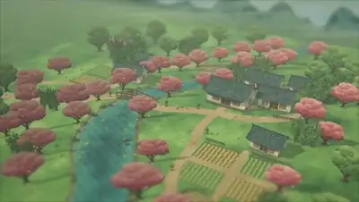</a><br><a href="https://www.sandbase.ai/lab/ai-videos/gpt-6-2-sol/2119409785900552548?utm_source=github&utm_medium=readme&utm_campaign=awesome-gpt-6-2-sol&utm_content=card"><b>A village shifting from day to night in Three.js</b></a><br><sub><a href="https://x.com/TokenGremlin/status/2119409785900552548">@TokenGremlin</a> · 0:05</sub></td><td width="33%" valign="top"><a href="https://www.sandbase.ai/lab/media/x/gpt-6-2-sol/2119423600692166703/video.mp4">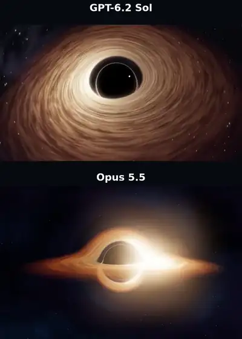</a><br><a href="https://www.sandbase.ai/lab/ai-videos/gpt-6-2-sol/2119423600692166703?utm_source=github&utm_medium=readme&utm_campaign=awesome-gpt-6-2-sol&utm_content=card"><b>A 3D creative scene created with Three.js</b></a><br><sub><a href="https://x.com/TokenGremlin/status/2119423600692166703">@TokenGremlin</a> · 0:10</sub></td><td width="33%" valign="top"><a href="https://www.sandbase.ai/lab/media/x/gpt-6-2-sol/2119437126194335764/video.mp4">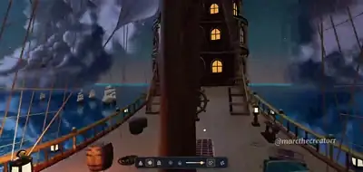</a><br><a href="https://www.sandbase.ai/lab/ai-videos/gpt-6-2-sol/2119437126194335764?utm_source=github&utm_medium=readme&utm_campaign=awesome-gpt-6-2-sol&utm_content=card"><b>Sailing ship rendered in Three.js</b></a><br><sub><a href="https://x.com/marcthecreatorr/status/2119437126194335764">@marcthecreatorr</a> · 0:53</sub></td></tr>
</table>

<details>
<summary><b>Show all 19</b></summary>

<table>
<tr><td width="33%" valign="top"><a href="https://www.sandbase.ai/lab/media/x/gpt-6-2-sol/2119437812604838342/video.mp4">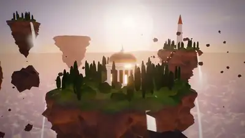</a><br><a href="https://www.sandbase.ai/lab/ai-videos/gpt-6-2-sol/2119437812604838342?utm_source=github&utm_medium=readme&utm_campaign=awesome-gpt-6-2-sol&utm_content=card"><b>Planet clouds and temple environment rendered from scratch</b></a><br><sub><a href="https://x.com/Mr_Salio/status/2119437812604838342">@Mr_Salio</a> · 0:51</sub></td><td width="33%" valign="top"><a href="https://www.sandbase.ai/lab/media/x/gpt-6-2-sol/2119445773909926181/video.mp4">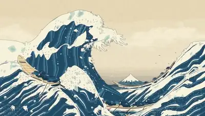</a><br><a href="https://www.sandbase.ai/lab/ai-videos/gpt-6-2-sol/2119445773909926181?utm_source=github&utm_medium=readme&utm_campaign=awesome-gpt-6-2-sol&utm_content=card"><b>A 3D giant ocean wave in Three.js</b></a><br><sub><a href="https://x.com/ai_funss/status/2119445773909926181">@ai_funss</a> · 0:05</sub></td><td width="33%" valign="top"><a href="https://www.sandbase.ai/lab/media/x/gpt-6-2-sol/2119464819229344113/video.mp4"></a><br><a href="https://www.sandbase.ai/lab/ai-videos/gpt-6-2-sol/2119464819229344113?utm_source=github&utm_medium=readme&utm_campaign=awesome-gpt-6-2-sol&utm_content=card"><b>Interactive tornado simulation in Three.js</b></a><br><sub><a href="https://x.com/Cayden970207/status/2119464819229344113">@Cayden970207</a> · 0:33 · <a href="https://www.sandbase.ai/lab/ai-videos/gpt-6-2-sol/2119464819229344113?utm_source=github&utm_medium=readme&utm_campaign=awesome-gpt-6-2-sol&utm_content=card">prompt</a></sub></td></tr>
<tr><td width="33%" valign="top"><a href="https://www.sandbase.ai/lab/media/x/gpt-6-2-sol/2119465155109196254/video.mp4">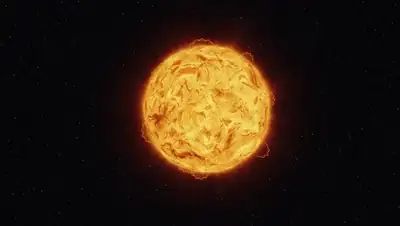</a><br><a href="https://www.sandbase.ai/lab/ai-videos/gpt-6-2-sol/2119465155109196254?utm_source=github&utm_medium=readme&utm_campaign=awesome-gpt-6-2-sol&utm_content=card"><b>Simulation of a supernova explosion in 3D</b></a><br><sub><a href="https://x.com/pankajkumar_dev/status/2119465155109196254">@pankajkumar_dev</a> · 0:30</sub></td><td width="33%" valign="top"><a href="https://www.sandbase.ai/lab/media/x/gpt-6-2-sol/2119469657291997366/video.mp4"></a><br><a href="https://www.sandbase.ai/lab/ai-videos/gpt-6-2-sol/2119469657291997366?utm_source=github&utm_medium=readme&utm_campaign=awesome-gpt-6-2-sol&utm_content=card"><b>Simulation of a black hole with gravitational lensing</b></a><br><sub><a href="https://x.com/pankajkumar_dev/status/2119469657291997366">@pankajkumar_dev</a> · 0:30</sub></td><td width="33%" valign="top"><a href="https://www.sandbase.ai/lab/media/x/gpt-6-2-sol/2119474833738354867/video.mp4">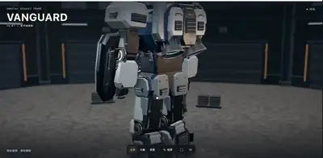</a><br><a href="https://www.sandbase.ai/lab/ai-videos/gpt-6-2-sol/2119474833738354867?utm_source=github&utm_medium=readme&utm_campaign=awesome-gpt-6-2-sol&utm_content=card"><b>A 3D Gundam running in Three.js</b></a><br><sub><a href="https://x.com/Cayden970207/status/2119474833738354867">@Cayden970207</a> · 0:21</sub></td></tr>
<tr><td width="33%" valign="top"><a href="https://www.sandbase.ai/lab/media/x/gpt-6-2-sol/2119507514459144677/video.mp4"></a><br><a href="https://www.sandbase.ai/lab/ai-videos/gpt-6-2-sol/2119507514459144677?utm_source=github&utm_medium=readme&utm_campaign=awesome-gpt-6-2-sol&utm_content=card"><b>An interactive Three.js scene of the end of time</b></a><br><sub><a href="https://x.com/Khazix0918/status/2119507514459144677">@Khazix0918</a> · 0:18 · <a href="https://www.sandbase.ai/lab/ai-videos/gpt-6-2-sol/2119507514459144677?utm_source=github&utm_medium=readme&utm_campaign=awesome-gpt-6-2-sol&utm_content=card">prompt</a></sub></td><td width="33%" valign="top"><a href="https://www.sandbase.ai/lab/media/x/gpt-6-2-sol/2119521331637285138/video.mp4">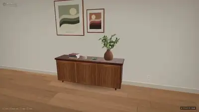</a><br><a href="https://www.sandbase.ai/lab/ai-videos/gpt-6-2-sol/2119521331637285138?utm_source=github&utm_medium=readme&utm_campaign=awesome-gpt-6-2-sol&utm_content=card"><b>3D kitchen scene rendered with GPT-6.2 Sol</b></a><br><sub><a href="https://x.com/mirochill/status/2119521331637285138">@mirochill</a> · 0:44</sub></td><td width="33%" valign="top"><a href="https://www.sandbase.ai/lab/media/x/gpt-6-2-sol/2119542842393530713/video.mp4"></a><br><a href="https://www.sandbase.ai/lab/ai-videos/gpt-6-2-sol/2119542842393530713?utm_source=github&utm_medium=readme&utm_campaign=awesome-gpt-6-2-sol&utm_content=card"><b>A portrait rendered by GPT-6.2 Sol</b></a><br><sub><a href="https://x.com/theaidesk_/status/2119542842393530713">@theaidesk_</a> · 0:22</sub></td></tr>
<tr><td width="33%" valign="top"><a href="https://www.sandbase.ai/lab/media/x/gpt-6-2-sol/2119626286373261752/video.mp4">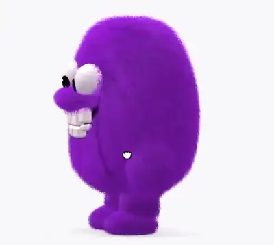</a><br><a href="https://www.sandbase.ai/lab/ai-videos/gpt-6-2-sol/2119626286373261752?utm_source=github&utm_medium=readme&utm_campaign=awesome-gpt-6-2-sol&utm_content=card"><b>A purple furball with teeth generated in Three.js</b></a><br><sub><a href="https://x.com/AnikaCodes/status/2119626286373261752">@AnikaCodes</a> · 0:04</sub></td><td width="33%" valign="top"><a href="https://www.sandbase.ai/lab/media/x/gpt-6-2-sol/2119802691530445058/video.mp4">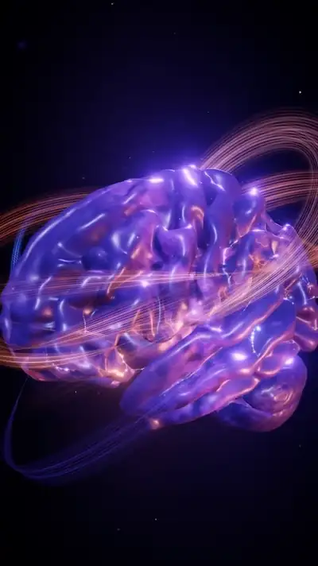</a><br><a href="https://www.sandbase.ai/lab/ai-videos/gpt-6-2-sol/2119802691530445058?utm_source=github&utm_medium=readme&utm_campaign=awesome-gpt-6-2-sol&utm_content=card"><b>3D brain and Elden Ring game test</b></a><br><sub><a href="https://x.com/Ionkosm/status/2119802691530445058">@Ionkosm</a> · 0:36</sub></td><td width="33%" valign="top"><a href="https://www.sandbase.ai/lab/media/x/gpt-6-2-sol/2119984136731738255/video.mp4"></a><br><a href="https://www.sandbase.ai/lab/ai-videos/gpt-6-2-sol/2119984136731738255?utm_source=github&utm_medium=readme&utm_campaign=awesome-gpt-6-2-sol&utm_content=card"><b>Voxel Eiffel Tower construction scene in Three.js</b></a><br><sub><a href="https://x.com/cfenghub/status/2119984136731738255">@cfenghub</a> · 0:41</sub></td></tr>
<tr><td width="33%" valign="top"><a href="https://www.sandbase.ai/lab/media/x/gpt-6-2-sol/2120545025893474415/video.mp4">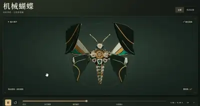</a><br><a href="https://www.sandbase.ai/lab/ai-videos/gpt-6-2-sol/2120545025893474415?utm_source=github&utm_medium=readme&utm_campaign=awesome-gpt-6-2-sol&utm_content=card"><b>Mechanical butterfly created in Three.js</b></a><br><sub><a href="https://x.com/dragono64v/status/2120545025893474415">@dragono64v</a> · 0:26</sub></td></tr>
</table>

</details>

<a id="motion-graphics"></a>

## Motion graphics

<table>
<tr><td width="33%" valign="top"><a href="https://www.sandbase.ai/lab/media/x/gpt-6-2-sol/2119495488445497489/video.mp4"></a><br><a href="https://www.sandbase.ai/lab/ai-videos/gpt-6-2-sol/2119495488445497489?utm_source=github&utm_medium=readme&utm_campaign=awesome-gpt-6-2-sol&utm_content=card"><b>Code-generated motion test with animations and glitch effects</b></a><br><sub><a href="https://x.com/BreezeOg1/status/2119495488445497489">@BreezeOg1</a> · 0:23</sub></td></tr>
</table>

<a id="game"></a>

## Games

<table>
<tr><td width="33%" valign="top"><a href="https://www.sandbase.ai/lab/media/x/gpt-6-2-sol/2119673965576655211/video.mp4"></a><br><a href="https://www.sandbase.ai/lab/ai-videos/gpt-6-2-sol/2119673965576655211?utm_source=github&utm_medium=readme&utm_campaign=awesome-gpt-6-2-sol&utm_content=card"><b>A space pirate game created with one prompt</b></a><br><sub><a href="https://x.com/Thomas_jorgen/status/2119673965576655211">@Thomas_jorgen</a> · 1:02</sub></td><td width="33%" valign="top"><a href="https://www.sandbase.ai/lab/media/x/gpt-6-2-sol/2120107337650155798/video.mp4"></a><br><a href="https://www.sandbase.ai/lab/ai-videos/gpt-6-2-sol/2120107337650155798?utm_source=github&utm_medium=readme&utm_campaign=awesome-gpt-6-2-sol&utm_content=card"><b>Childhood rug turned into a playable game</b></a><br><sub><a href="https://x.com/noclipepe/status/2120107337650155798">@noclipepe</a> · 0:55</sub></td><td width="33%" valign="top"><a href="https://www.sandbase.ai/lab/media/x/gpt-6-2-sol/2120490910278418869/video.mp4">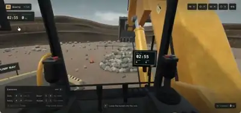</a><br><a href="https://www.sandbase.ai/lab/ai-videos/gpt-6-2-sol/2120490910278418869?utm_source=github&utm_medium=readme&utm_campaign=awesome-gpt-6-2-sol&utm_content=card"><b>Playable 3D excavator game</b></a><br><sub><a href="https://x.com/Frtnel/status/2120490910278418869">@Frtnel</a> · 0:36</sub></td></tr>
</table>

<a id="comparison"></a>

## Tests & comparisons

<table>
<tr><td width="33%" valign="top"><a href="https://www.sandbase.ai/lab/media/x/gpt-6-2-sol/2119433734059401260/video.mp4"></a><br><a href="https://www.sandbase.ai/lab/ai-videos/gpt-6-2-sol/2119433734059401260?utm_source=github&utm_medium=readme&utm_campaign=awesome-gpt-6-2-sol&utm_content=card"><b>Comparing Codex and API results for 3D generation</b></a><br><sub><a href="https://x.com/JustinGorya/status/2119433734059401260">@JustinGorya</a> · 0:07</sub></td><td width="33%" valign="top"><a href="https://www.sandbase.ai/lab/media/x/gpt-6-2-sol/2119473497504428334/video.mp4">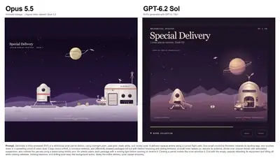</a><br><a href="https://www.sandbase.ai/lab/ai-videos/gpt-6-2-sol/2119473497504428334?utm_source=github&utm_medium=readme&utm_campaign=awesome-gpt-6-2-sol&utm_content=card"><b>Animated SVGs comparison between two models</b></a><br><sub><a href="https://x.com/Ananth7e/status/2119473497504428334">@Ananth7e</a> · 2:17</sub></td><td width="33%" valign="top"><a href="https://www.sandbase.ai/lab/media/x/gpt-6-2-sol/2119473712751649201/video.mp4">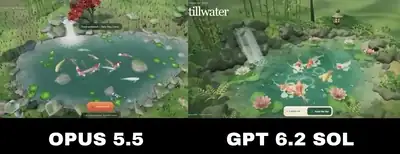</a><br><a href="https://www.sandbase.ai/lab/ai-videos/gpt-6-2-sol/2119473712751649201?utm_source=github&utm_medium=readme&utm_campaign=awesome-gpt-6-2-sol&utm_content=card"><b>Comparing GPT-6.2 Sol and Opus 5.5 animation generation</b></a><br><sub><a href="https://x.com/vikktorrrre/status/2119473712751649201">@vikktorrrre</a> · 0:35</sub></td></tr>
<tr><td width="33%" valign="top"><a href="https://www.sandbase.ai/lab/media/x/gpt-6-2-sol/2119483038924972047/video.mp4"></a><br><a href="https://www.sandbase.ai/lab/ai-videos/gpt-6-2-sol/2119483038924972047?utm_source=github&utm_medium=readme&utm_campaign=awesome-gpt-6-2-sol&utm_content=card"><b>Black hole scene comparison between two models</b></a><br><sub><a href="https://x.com/k0dzilla/status/2119483038924972047">@k0dzilla</a> · 0:12</sub></td><td width="33%" valign="top"><a href="https://www.sandbase.ai/lab/media/x/gpt-6-2-sol/2119503807654535300/video.mp4"></a><br><a href="https://www.sandbase.ai/lab/ai-videos/gpt-6-2-sol/2119503807654535300?utm_source=github&utm_medium=readme&utm_campaign=awesome-gpt-6-2-sol&utm_content=card"><b>Night windows scene comparison between two models</b></a><br><sub><a href="https://x.com/theaidesk_/status/2119503807654535300">@theaidesk_</a> · 0:30</sub></td><td width="33%" valign="top"><a href="https://www.sandbase.ai/lab/media/x/gpt-6-2-sol/2119516309851361758/video.mp4">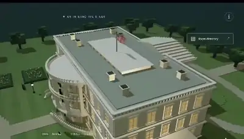</a><br><a href="https://www.sandbase.ai/lab/ai-videos/gpt-6-2-sol/2119516309851361758?utm_source=github&utm_medium=readme&utm_campaign=awesome-gpt-6-2-sol&utm_content=card"><b>Prompt test comparison with AI models</b></a><br><sub><a href="https://x.com/theaidesk_/status/2119516309851361758">@theaidesk_</a> · 0:43</sub></td></tr>
</table>

<details>
<summary><b>Show all 9</b></summary>

<table>
<tr><td width="33%" valign="top"><a href="https://www.sandbase.ai/lab/media/x/gpt-6-2-sol/2119527377109672111/video.mp4">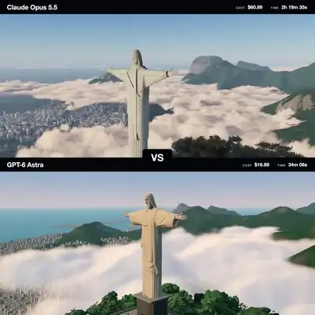</a><br><a href="https://www.sandbase.ai/lab/ai-videos/gpt-6-2-sol/2119527377109672111?utm_source=github&utm_medium=readme&utm_campaign=awesome-gpt-6-2-sol&utm_content=card"><b>Comparison of Three.js 3D output between two models</b></a><br><sub><a href="https://x.com/EnvolDev/status/2119527377109672111">@EnvolDev</a> · 0:25</sub></td><td width="33%" valign="top"><a href="https://www.sandbase.ai/lab/media/x/gpt-6-2-sol/2119728047754547326/video.mp4"></a><br><a href="https://www.sandbase.ai/lab/ai-videos/gpt-6-2-sol/2119728047754547326?utm_source=github&utm_medium=readme&utm_campaign=awesome-gpt-6-2-sol&utm_content=card"><b>A rug racing game comparison between two models</b></a><br><sub><a href="https://x.com/noclipepe/status/2119728047754547326">@noclipepe</a> · 1:14</sub></td><td width="33%" valign="top"><a href="https://www.sandbase.ai/lab/media/x/gpt-6-2-sol/2119743048364277820/video.mp4">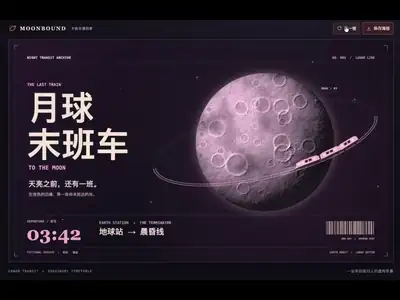</a><br><a href="https://www.sandbase.ai/lab/ai-videos/gpt-6-2-sol/2119743048364277820?utm_source=github&utm_medium=readme&utm_campaign=awesome-gpt-6-2-sol&utm_content=card"><b>Webpage design comparison between two models</b></a><br><sub><a href="https://x.com/Stargridcompass/status/2119743048364277820">@Stargridcompass</a> · 0:16 · <a href="https://www.sandbase.ai/lab/ai-videos/gpt-6-2-sol/2119743048364277820?utm_source=github&utm_medium=readme&utm_campaign=awesome-gpt-6-2-sol&utm_content=card">prompt</a></sub></td></tr>
</table>

</details>

**[See all 32 on SandBase Lab →](https://www.sandbase.ai/lab/ai-videos/gpt-6-2-sol?utm_source=github&utm_medium=readme&utm_campaign=awesome-gpt-6-2-sol&utm_content=section)**

<a id="recreate"></a>

## Recreate a video with GPT-6.2 Sol

Every video page on [SandBase Lab](https://www.sandbase.ai/lab/ai-videos/gpt-6-2-sol?utm_source=github&utm_medium=readme&utm_campaign=awesome-gpt-6-2-sol&utm_content=recreate) has a **Recreate** button: it sends the post to GPT-6.2 Sol in the Lab text arena and returns the code, ready to play in the browser.

With the API, GPT-6.2 Sol is `openai/gpt-6.2-sol` on SandBase (OpenAI-compatible). Put a prompt in `prompt.txt`, create a key in the [console](https://www.sandbase.ai/console/keys?utm_source=github&utm_medium=readme&utm_campaign=awesome-gpt-6-2-sol), and run:

```bash
jq -n --rawfile prompt prompt.txt \
  '{model: "openai/gpt-6.2-sol", max_tokens: 128000, messages: [{role: "user", content: $prompt}]}' |
curl -sS --max-time 900 https://api.sandbase.ai/v1/chat/completions \
  -H "Authorization: Bearer $SANDBASE_API_KEY" \
  -H "Content-Type: application/json" \
  -d @- | jq -r '.choices[0].message.content' | sed '/^```/d' > gpt-6-2-sol.html
```

Open `gpt-6-2-sol.html` in a browser, or run it in a [SandBox](https://www.sandbase.ai/landing/sandbox?utm_source=github&utm_medium=readme&utm_campaign=awesome-gpt-6-2-sol) to keep generated code isolated. The call above asks for `max_tokens` of 128,000 to leave room for a long page. Full walkthrough: [tutorial](docs/tutorial.md). Pricing: [model page](https://www.sandbase.ai/model/openai/gpt-6.2-sol?utm_source=github&utm_medium=readme&utm_campaign=awesome-gpt-6-2-sol).

<a id="faq"></a>

## FAQ

### What is GPT-6.2 Sol?

GPT-6.2 Sol is OpenAI's model in the GPT-6.2 line, announced on November 8, 2026 and served on SandBase as `openai/gpt-6.2-sol`. Creators who posted about it in its first days reported strong front-end and 3D design work. Source: the Lab collection record and `sandbase inspect openai/gpt-6.2-sol`.

### How are these GPT-6.2 Sol videos made?

The model doesn't render video. It writes a web page, usually Three.js for 3D scenes, and the creator records the page playing. The creators in this list posted a one-shot brief, a one-line brief with an interactive Three.js scene, and a same-prompt head-to-head. See the [tutorial](docs/tutorial.md).

### Where do I find the prompt for a video?

Videos tagged **prompt** come with the creator's prompt on their Lab page. The [prompt index](docs/prompts.md) lists all of them.

### How do I write a good GPT-6.2 Sol prompt?

Name one self-contained HTML file and the renderer you want (for example Three.js), describe the scene and the interaction you want, and ask for the finished, playable result. Details and a template: [prompt guide](docs/prompt-guide.md).

### How do I use the GPT-6.2 Sol API?

On SandBase the model id is `openai/gpt-6.2-sol` on the OpenAI-compatible `/v1/chat/completions` endpoint. One key works for every model. See [Recreate](#recreate) and the [model page](https://www.sandbase.ai/model/openai/gpt-6.2-sol?utm_source=github&utm_medium=readme&utm_campaign=awesome-gpt-6-2-sol).

### Is GPT-6.2 Sol better than Claude Opus 5.5?

There is no measured answer yet: the Lab [Evals boards](https://www.sandbase.ai/leaderboards?utm_source=github&utm_medium=readme&utm_campaign=awesome-gpt-6-2-sol) and the [Pelican Test](https://www.sandbase.ai/arena/pelican-test?utm_source=github&utm_medium=readme&utm_campaign=awesome-gpt-6-2-sol) had no GPT-6.2 Sol result when this list was built. One creator ran the same frontend prompt on GPT-6.2 Sol and Claude Opus 5.5 side by side and reported a clear front-end design gain for GPT-6.2 Sol, and asked viewers to judge. Details: [model comparison](docs/model-comparison.md).

### How much does one video cost?

The creator posts in this list do not state a cost, so this list does not give one. The list price is on the [model page](https://www.sandbase.ai/model/openai/gpt-6.2-sol?utm_source=github&utm_medium=readme&utm_campaign=awesome-gpt-6-2-sol).

### Can I reuse these videos?

No, not by default. They belong to their creators. See [MEDIA-RIGHTS](MEDIA-RIGHTS.md).

<a id="contribute"></a>

## Suggest a video

Know a GPT-6.2 Sol creation that should be here? [Open a submission](https://github.com/sandbase-lab/awesome-gpt-6-2-sol/issues/new?template=submit-video.yml) with the original X post. Accepted posts are added on SandBase Lab and show up here on the next daily sync. If this list helped you, a ⭐ helps others find it.

## Credits & rights

Every video, prompt and post belongs to its creator. Cards credit the author and link to the original post. The MIT license covers this repository's scripts only. To correct a credit or remove a video, see [MEDIA-RIGHTS](MEDIA-RIGHTS.md).

Not affiliated with or endorsed by OpenAI.

---

Maintained by [SandBase Lab](https://www.sandbase.ai/lab/?utm_source=github&utm_medium=readme&utm_campaign=awesome-gpt-6-2-sol) · [All AI video collections](https://www.sandbase.ai/lab/ai-videos?utm_source=github&utm_medium=readme&utm_campaign=awesome-gpt-6-2-sol)
