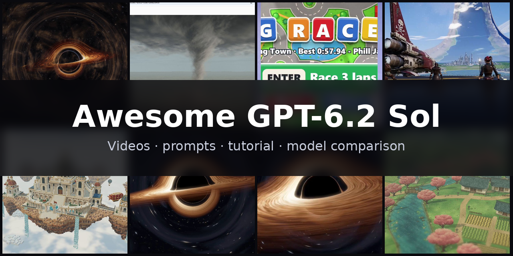
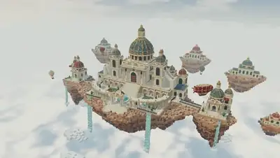
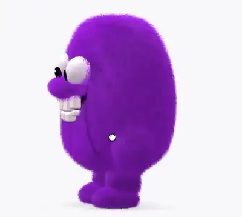
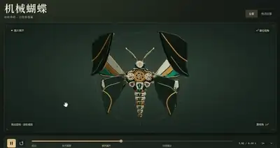
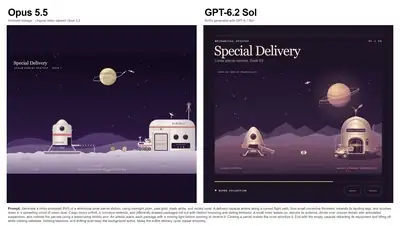
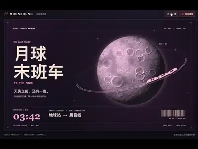

# Awesome GPT-6.2 Sol

[English](README.md) · 简体中文

[](https://awesome.re) [](#contents) [](docs/zh-CN/prompts.md) [](https://github.com/sandbase-lab/awesome-gpt-6-2-sol/actions/workflows/sync.yml) [](https://www.sandbase.ai/model/openai/gpt-6.2-sol?utm_source=github&utm_medium=readme&utm_campaign=awesome-gpt-6-2-sol)

[](https://www.sandbase.ai/lab/ai-videos/gpt-6-2-sol?lang=zh-CN&utm_source=github&utm_medium=readme&utm_campaign=awesome-gpt-6-2-sol&utm_content=banner)

精选 **GPT-6.2 Sol 案例**合集：用 GPT-6.2 Sol（OpenAI 的模型，2026 年 11 月 8 日宣布）做出的视频、提示词和演示。以 Three.js 3D 场景和可在浏览器里玩的页面为主，也包括与其他模型的同提示词对比；均注明作者并链接原帖。

共 **32 条视频**，来自 **24 位创作者** · **3 条**附作者提示词 · 每天从 [SandBase Lab](https://www.sandbase.ai/lab/ai-videos/gpt-6-2-sol?lang=zh-CN&utm_source=github&utm_medium=readme&utm_campaign=awesome-gpt-6-2-sol&utm_content=stats) 同步

## 从这里开始

| 我想… | 去这里 |
|---|---|
| 看视频 | 在下方 [按分类浏览](#contents)，或 [在 SandBase Lab 大屏播放](https://www.sandbase.ai/lab/ai-videos/gpt-6-2-sol?lang=zh-CN&utm_source=github&utm_medium=readme&utm_campaign=awesome-gpt-6-2-sol&utm_content=quickstart) |
| 复制提示词 | [提示词索引](docs/zh-CN/prompts.md)：所有附带提示词的视频 |
| 自己写提示词 | [提示词写法](docs/zh-CN/prompt-guide.md)：3 条写法和一个填空模板 |
| 做一个视频 | [教程](docs/zh-CN/tutorial.md)：提示词 → HTML → MP4，含 API 调用和录屏脚本 |
| 选模型 | [GPT-6.2 Sol 与对手对比](docs/zh-CN/model-comparison.md)：实测与创作者报告分开看 |
| 马上试试 | [在 Lab 竞技场运行 GPT-6.2 Sol](https://www.sandbase.ai/arena/text?models=openai%2Fgpt-6.2-sol&lang=zh-CN&utm_source=github&utm_medium=readme&utm_campaign=awesome-gpt-6-2-sol&utm_content=quickstart)，和其他模型并排对比 |

<a id="contents"></a>

## 目录

- [精选](#featured) (5)
- [3D 场景](#3d-scene) (19)
- [动效](#motion-graphics) (1)
- [游戏](#game) (3)
- [测试对比](#comparison) (9)
- [用 GPT-6.2 Sol 复刻视频](#recreate)
- [常见问题](#faq)
- [推荐作品](#contribute)

点击预览图播放视频；点击标题前往 SandBase Lab 查看原帖、提示词，并一键 **复刻**；**@作者** 链接到 X 原帖。

<a id="featured"></a>

## 精选

<table>
<tr><td width="33%" valign="top"><a href="https://www.sandbase.ai/lab/media/x/gpt-6-2-sol/2119469657291997366/video.mp4"></a><br><a href="https://www.sandbase.ai/lab/ai-videos/gpt-6-2-sol/2119469657291997366?lang=zh-CN&utm_source=github&utm_medium=readme&utm_campaign=awesome-gpt-6-2-sol&utm_content=card"><b>带引力透镜效果的3D黑洞模拟</b></a><br><sub><a href="https://x.com/pankajkumar_dev/status/2119469657291997366">@pankajkumar_dev</a> · 0:30</sub></td><td width="33%" valign="top"><a href="https://www.sandbase.ai/lab/media/x/gpt-6-2-sol/2119464819229344113/video.mp4"></a><br><a href="https://www.sandbase.ai/lab/ai-videos/gpt-6-2-sol/2119464819229344113?lang=zh-CN&utm_source=github&utm_medium=readme&utm_campaign=awesome-gpt-6-2-sol&utm_content=card"><b>Three.js中的可交互逼真龙卷风</b></a><br><sub><a href="https://x.com/Cayden970207/status/2119464819229344113">@Cayden970207</a> · 0:33 · <a href="https://www.sandbase.ai/lab/ai-videos/gpt-6-2-sol/2119464819229344113?lang=zh-CN&utm_source=github&utm_medium=readme&utm_campaign=awesome-gpt-6-2-sol&utm_content=card">提示词</a></sub></td><td width="33%" valign="top"><a href="https://www.sandbase.ai/lab/media/x/gpt-6-2-sol/2119495488445497489/video.mp4"></a><br><a href="https://www.sandbase.ai/lab/ai-videos/gpt-6-2-sol/2119495488445497489?lang=zh-CN&utm_source=github&utm_medium=readme&utm_campaign=awesome-gpt-6-2-sol&utm_content=card"><b>代码生成的动作测试包含动画与故障效果</b></a><br><sub><a href="https://x.com/BreezeOg1/status/2119495488445497489">@BreezeOg1</a> · 0:23</sub></td></tr>
<tr><td width="33%" valign="top"><a href="https://www.sandbase.ai/lab/media/x/gpt-6-2-sol/2120107337650155798/video.mp4"></a><br><a href="https://www.sandbase.ai/lab/ai-videos/gpt-6-2-sol/2120107337650155798?lang=zh-CN&utm_source=github&utm_medium=readme&utm_campaign=awesome-gpt-6-2-sol&utm_content=card"><b>将童年地毯制作成可玩赛车游戏</b></a><br><sub><a href="https://x.com/noclipepe/status/2120107337650155798">@noclipepe</a> · 0:55</sub></td><td width="33%" valign="top"><a href="https://www.sandbase.ai/lab/media/x/gpt-6-2-sol/2119673965576655211/video.mp4"></a><br><a href="https://www.sandbase.ai/lab/ai-videos/gpt-6-2-sol/2119673965576655211?lang=zh-CN&utm_source=github&utm_medium=readme&utm_campaign=awesome-gpt-6-2-sol&utm_content=card"><b>单提示词生成的太空海盗游戏</b></a><br><sub><a href="https://x.com/Thomas_jorgen/status/2119673965576655211">@Thomas_jorgen</a> · 1:02</sub></td></tr>
</table>

<a id="3d-scene"></a>

## 3D 场景

<table>
<tr><td width="33%" valign="top"><a href="https://www.sandbase.ai/lab/media/x/gpt-6-2-sol/2119371334878744648/video.mp4"></a><br><a href="https://www.sandbase.ai/lab/ai-videos/gpt-6-2-sol/2119371334878744648?lang=zh-CN&utm_source=github&utm_medium=readme&utm_campaign=awesome-gpt-6-2-sol&utm_content=card"><b>单提示词生成的Three.js 3D场景</b></a><br><sub><a href="https://x.com/TokenGremlin/status/2119371334878744648">@TokenGremlin</a> · 0:05</sub></td><td width="33%" valign="top"><a href="https://www.sandbase.ai/lab/media/x/gpt-6-2-sol/2119395930805879165/video.mp4"></a><br><a href="https://www.sandbase.ai/lab/ai-videos/gpt-6-2-sol/2119395930805879165?lang=zh-CN&utm_source=github&utm_medium=readme&utm_campaign=awesome-gpt-6-2-sol&utm_content=card"><b>用Three.js生成的黑洞场景</b></a><br><sub><a href="https://x.com/TokenGremlin/status/2119395930805879165">@TokenGremlin</a> · 0:06</sub></td><td width="33%" valign="top"><a href="https://www.sandbase.ai/lab/media/x/gpt-6-2-sol/2119407882949288298/video.mp4"></a><br><a href="https://www.sandbase.ai/lab/ai-videos/gpt-6-2-sol/2119407882949288298?lang=zh-CN&utm_source=github&utm_medium=readme&utm_campaign=awesome-gpt-6-2-sol&utm_content=card"><b>Three.js 一次性生成的黑洞视觉模拟</b></a><br><sub><a href="https://x.com/YxzRainy/status/2119407882949288298">@YxzRainy</a> · 0:08</sub></td></tr>
<tr><td width="33%" valign="top"><a href="https://www.sandbase.ai/lab/media/x/gpt-6-2-sol/2119409785900552548/video.mp4"></a><br><a href="https://www.sandbase.ai/lab/ai-videos/gpt-6-2-sol/2119409785900552548?lang=zh-CN&utm_source=github&utm_medium=readme&utm_campaign=awesome-gpt-6-2-sol&utm_content=card"><b>Three.js构建的昼夜交替村落</b></a><br><sub><a href="https://x.com/TokenGremlin/status/2119409785900552548">@TokenGremlin</a> · 0:05</sub></td><td width="33%" valign="top"><a href="https://www.sandbase.ai/lab/media/x/gpt-6-2-sol/2119423600692166703/video.mp4"></a><br><a href="https://www.sandbase.ai/lab/ai-videos/gpt-6-2-sol/2119423600692166703?lang=zh-CN&utm_source=github&utm_medium=readme&utm_campaign=awesome-gpt-6-2-sol&utm_content=card"><b>Three.js生成的3D创意场景展示</b></a><br><sub><a href="https://x.com/TokenGremlin/status/2119423600692166703">@TokenGremlin</a> · 0:10</sub></td><td width="33%" valign="top"><a href="https://www.sandbase.ai/lab/media/x/gpt-6-2-sol/2119437126194335764/video.mp4"></a><br><a href="https://www.sandbase.ai/lab/ai-videos/gpt-6-2-sol/2119437126194335764?lang=zh-CN&utm_source=github&utm_medium=readme&utm_campaign=awesome-gpt-6-2-sol&utm_content=card"><b>Three.js实时渲染的3D帆船</b></a><br><sub><a href="https://x.com/marcthecreatorr/status/2119437126194335764">@marcthecreatorr</a> · 0:53</sub></td></tr>
</table>

<details>
<summary><b>展开全部 19 条</b></summary>

<table>
<tr><td width="33%" valign="top"><a href="https://www.sandbase.ai/lab/media/x/gpt-6-2-sol/2119437812604838342/video.mp4"></a><br><a href="https://www.sandbase.ai/lab/ai-videos/gpt-6-2-sol/2119437812604838342?lang=zh-CN&utm_source=github&utm_medium=readme&utm_campaign=awesome-gpt-6-2-sol&utm_content=card"><b>从零构建的行星云层与神庙环境</b></a><br><sub><a href="https://x.com/Mr_Salio/status/2119437812604838342">@Mr_Salio</a> · 0:51</sub></td><td width="33%" valign="top"><a href="https://www.sandbase.ai/lab/media/x/gpt-6-2-sol/2119445773909926181/video.mp4"></a><br><a href="https://www.sandbase.ai/lab/ai-videos/gpt-6-2-sol/2119445773909926181?lang=zh-CN&utm_source=github&utm_medium=readme&utm_campaign=awesome-gpt-6-2-sol&utm_content=card"><b>Three.js 纯代码生成的 3D 巨浪场景</b></a><br><sub><a href="https://x.com/ai_funss/status/2119445773909926181">@ai_funss</a> · 0:05</sub></td><td width="33%" valign="top"><a href="https://www.sandbase.ai/lab/media/x/gpt-6-2-sol/2119464819229344113/video.mp4"></a><br><a href="https://www.sandbase.ai/lab/ai-videos/gpt-6-2-sol/2119464819229344113?lang=zh-CN&utm_source=github&utm_medium=readme&utm_campaign=awesome-gpt-6-2-sol&utm_content=card"><b>Three.js中的可交互逼真龙卷风</b></a><br><sub><a href="https://x.com/Cayden970207/status/2119464819229344113">@Cayden970207</a> · 0:33 · <a href="https://www.sandbase.ai/lab/ai-videos/gpt-6-2-sol/2119464819229344113?lang=zh-CN&utm_source=github&utm_medium=readme&utm_campaign=awesome-gpt-6-2-sol&utm_content=card">提示词</a></sub></td></tr>
<tr><td width="33%" valign="top"><a href="https://www.sandbase.ai/lab/media/x/gpt-6-2-sol/2119465155109196254/video.mp4"></a><br><a href="https://www.sandbase.ai/lab/ai-videos/gpt-6-2-sol/2119465155109196254?lang=zh-CN&utm_source=github&utm_medium=readme&utm_campaign=awesome-gpt-6-2-sol&utm_content=card"><b>电影级3D超新星爆发模拟</b></a><br><sub><a href="https://x.com/pankajkumar_dev/status/2119465155109196254">@pankajkumar_dev</a> · 0:30</sub></td><td width="33%" valign="top"><a href="https://www.sandbase.ai/lab/media/x/gpt-6-2-sol/2119469657291997366/video.mp4"></a><br><a href="https://www.sandbase.ai/lab/ai-videos/gpt-6-2-sol/2119469657291997366?lang=zh-CN&utm_source=github&utm_medium=readme&utm_campaign=awesome-gpt-6-2-sol&utm_content=card"><b>带引力透镜效果的3D黑洞模拟</b></a><br><sub><a href="https://x.com/pankajkumar_dev/status/2119469657291997366">@pankajkumar_dev</a> · 0:30</sub></td><td width="33%" valign="top"><a href="https://www.sandbase.ai/lab/media/x/gpt-6-2-sol/2119474833738354867/video.mp4"></a><br><a href="https://www.sandbase.ai/lab/ai-videos/gpt-6-2-sol/2119474833738354867?lang=zh-CN&utm_source=github&utm_medium=readme&utm_campaign=awesome-gpt-6-2-sol&utm_content=card"><b>单文件 Three.js 运行的 3D 高达模型</b></a><br><sub><a href="https://x.com/Cayden970207/status/2119474833738354867">@Cayden970207</a> · 0:21</sub></td></tr>
<tr><td width="33%" valign="top"><a href="https://www.sandbase.ai/lab/media/x/gpt-6-2-sol/2119507514459144677/video.mp4"></a><br><a href="https://www.sandbase.ai/lab/ai-videos/gpt-6-2-sol/2119507514459144677?lang=zh-CN&utm_source=github&utm_medium=readme&utm_campaign=awesome-gpt-6-2-sol&utm_content=card"><b>以《时间的尽头》为主题的交互式3D场景</b></a><br><sub><a href="https://x.com/Khazix0918/status/2119507514459144677">@Khazix0918</a> · 0:18 · <a href="https://www.sandbase.ai/lab/ai-videos/gpt-6-2-sol/2119507514459144677?lang=zh-CN&utm_source=github&utm_medium=readme&utm_campaign=awesome-gpt-6-2-sol&utm_content=card">提示词</a></sub></td><td width="33%" valign="top"><a href="https://www.sandbase.ai/lab/media/x/gpt-6-2-sol/2119521331637285138/video.mp4"></a><br><a href="https://www.sandbase.ai/lab/ai-videos/gpt-6-2-sol/2119521331637285138?lang=zh-CN&utm_source=github&utm_medium=readme&utm_campaign=awesome-gpt-6-2-sol&utm_content=card"><b>GPT-6.2 Sol 渲染的 3D 厨房场景</b></a><br><sub><a href="https://x.com/mirochill/status/2119521331637285138">@mirochill</a> · 0:44</sub></td><td width="33%" valign="top"><a href="https://www.sandbase.ai/lab/media/x/gpt-6-2-sol/2119542842393530713/video.mp4"></a><br><a href="https://www.sandbase.ai/lab/ai-videos/gpt-6-2-sol/2119542842393530713?lang=zh-CN&utm_source=github&utm_medium=readme&utm_campaign=awesome-gpt-6-2-sol&utm_content=card"><b>GPT-6.2 Sol 渲染的人物肖像</b></a><br><sub><a href="https://x.com/theaidesk_/status/2119542842393530713">@theaidesk_</a> · 0:22</sub></td></tr>
<tr><td width="33%" valign="top"><a href="https://www.sandbase.ai/lab/media/x/gpt-6-2-sol/2119626286373261752/video.mp4"></a><br><a href="https://www.sandbase.ai/lab/ai-videos/gpt-6-2-sol/2119626286373261752?lang=zh-CN&utm_source=github&utm_medium=readme&utm_campaign=awesome-gpt-6-2-sol&utm_content=card"><b>Three.js 生成的长牙紫色毛球</b></a><br><sub><a href="https://x.com/AnikaCodes/status/2119626286373261752">@AnikaCodes</a> · 0:04</sub></td><td width="33%" valign="top"><a href="https://www.sandbase.ai/lab/media/x/gpt-6-2-sol/2119802691530445058/video.mp4"></a><br><a href="https://www.sandbase.ai/lab/ai-videos/gpt-6-2-sol/2119802691530445058?lang=zh-CN&utm_source=github&utm_medium=readme&utm_campaign=awesome-gpt-6-2-sol&utm_content=card"><b>3D 大脑与类艾尔登法环视觉测试</b></a><br><sub><a href="https://x.com/Ionkosm/status/2119802691530445058">@Ionkosm</a> · 0:36</sub></td><td width="33%" valign="top"><a href="https://www.sandbase.ai/lab/media/x/gpt-6-2-sol/2119984136731738255/video.mp4"></a><br><a href="https://www.sandbase.ai/lab/ai-videos/gpt-6-2-sol/2119984136731738255?lang=zh-CN&utm_source=github&utm_medium=readme&utm_campaign=awesome-gpt-6-2-sol&utm_content=card"><b>Three.js 纯代码生成的体素埃菲尔铁塔施工场景</b></a><br><sub><a href="https://x.com/cfenghub/status/2119984136731738255">@cfenghub</a> · 0:41</sub></td></tr>
<tr><td width="33%" valign="top"><a href="https://www.sandbase.ai/lab/media/x/gpt-6-2-sol/2120545025893474415/video.mp4"></a><br><a href="https://www.sandbase.ai/lab/ai-videos/gpt-6-2-sol/2120545025893474415?lang=zh-CN&utm_source=github&utm_medium=readme&utm_campaign=awesome-gpt-6-2-sol&utm_content=card"><b>使用Three.js构建的机械蝴蝶</b></a><br><sub><a href="https://x.com/dragono64v/status/2120545025893474415">@dragono64v</a> · 0:26</sub></td></tr>
</table>

</details>

<a id="motion-graphics"></a>

## 动效

<table>
<tr><td width="33%" valign="top"><a href="https://www.sandbase.ai/lab/media/x/gpt-6-2-sol/2119495488445497489/video.mp4"></a><br><a href="https://www.sandbase.ai/lab/ai-videos/gpt-6-2-sol/2119495488445497489?lang=zh-CN&utm_source=github&utm_medium=readme&utm_campaign=awesome-gpt-6-2-sol&utm_content=card"><b>代码生成的动作测试包含动画与故障效果</b></a><br><sub><a href="https://x.com/BreezeOg1/status/2119495488445497489">@BreezeOg1</a> · 0:23</sub></td></tr>
</table>

<a id="game"></a>

## 游戏

<table>
<tr><td width="33%" valign="top"><a href="https://www.sandbase.ai/lab/media/x/gpt-6-2-sol/2119673965576655211/video.mp4"></a><br><a href="https://www.sandbase.ai/lab/ai-videos/gpt-6-2-sol/2119673965576655211?lang=zh-CN&utm_source=github&utm_medium=readme&utm_campaign=awesome-gpt-6-2-sol&utm_content=card"><b>单提示词生成的太空海盗游戏</b></a><br><sub><a href="https://x.com/Thomas_jorgen/status/2119673965576655211">@Thomas_jorgen</a> · 1:02</sub></td><td width="33%" valign="top"><a href="https://www.sandbase.ai/lab/media/x/gpt-6-2-sol/2120107337650155798/video.mp4"></a><br><a href="https://www.sandbase.ai/lab/ai-videos/gpt-6-2-sol/2120107337650155798?lang=zh-CN&utm_source=github&utm_medium=readme&utm_campaign=awesome-gpt-6-2-sol&utm_content=card"><b>将童年地毯制作成可玩赛车游戏</b></a><br><sub><a href="https://x.com/noclipepe/status/2120107337650155798">@noclipepe</a> · 0:55</sub></td><td width="33%" valign="top"><a href="https://www.sandbase.ai/lab/media/x/gpt-6-2-sol/2120490910278418869/video.mp4"></a><br><a href="https://www.sandbase.ai/lab/ai-videos/gpt-6-2-sol/2120490910278418869?lang=zh-CN&utm_source=github&utm_medium=readme&utm_campaign=awesome-gpt-6-2-sol&utm_content=card"><b>可玩的3D挖掘机游戏</b></a><br><sub><a href="https://x.com/Frtnel/status/2120490910278418869">@Frtnel</a> · 0:36</sub></td></tr>
</table>

<a id="comparison"></a>

## 测试对比

<table>
<tr><td width="33%" valign="top"><a href="https://www.sandbase.ai/lab/media/x/gpt-6-2-sol/2119433734059401260/video.mp4"></a><br><a href="https://www.sandbase.ai/lab/ai-videos/gpt-6-2-sol/2119433734059401260?lang=zh-CN&utm_source=github&utm_medium=readme&utm_campaign=awesome-gpt-6-2-sol&utm_content=card"><b>Codex与API同提示词3D生成效果对比</b></a><br><sub><a href="https://x.com/JustinGorya/status/2119433734059401260">@JustinGorya</a> · 0:07</sub></td><td width="33%" valign="top"><a href="https://www.sandbase.ai/lab/media/x/gpt-6-2-sol/2119473497504428334/video.mp4"></a><br><a href="https://www.sandbase.ai/lab/ai-videos/gpt-6-2-sol/2119473497504428334?lang=zh-CN&utm_source=github&utm_medium=readme&utm_campaign=awesome-gpt-6-2-sol&utm_content=card"><b>两款模型的SVG动画效果对比</b></a><br><sub><a href="https://x.com/Ananth7e/status/2119473497504428334">@Ananth7e</a> · 2:17</sub></td><td width="33%" valign="top"><a href="https://www.sandbase.ai/lab/media/x/gpt-6-2-sol/2119473712751649201/video.mp4"></a><br><a href="https://www.sandbase.ai/lab/ai-videos/gpt-6-2-sol/2119473712751649201?lang=zh-CN&utm_source=github&utm_medium=readme&utm_campaign=awesome-gpt-6-2-sol&utm_content=card"><b>GPT-6.2 Sol与Opus 5.5动画生成效果对比</b></a><br><sub><a href="https://x.com/vikktorrrre/status/2119473712751649201">@vikktorrrre</a> · 0:35</sub></td></tr>
<tr><td width="33%" valign="top"><a href="https://www.sandbase.ai/lab/media/x/gpt-6-2-sol/2119483038924972047/video.mp4"></a><br><a href="https://www.sandbase.ai/lab/ai-videos/gpt-6-2-sol/2119483038924972047?lang=zh-CN&utm_source=github&utm_medium=readme&utm_campaign=awesome-gpt-6-2-sol&utm_content=card"><b>两款模型生成黑洞场景效果对比</b></a><br><sub><a href="https://x.com/k0dzilla/status/2119483038924972047">@k0dzilla</a> · 0:12</sub></td><td width="33%" valign="top"><a href="https://www.sandbase.ai/lab/media/x/gpt-6-2-sol/2119503807654535300/video.mp4"></a><br><a href="https://www.sandbase.ai/lab/ai-videos/gpt-6-2-sol/2119503807654535300?lang=zh-CN&utm_source=github&utm_medium=readme&utm_campaign=awesome-gpt-6-2-sol&utm_content=card"><b>两款模型生成夜间窗景同提示词对比</b></a><br><sub><a href="https://x.com/theaidesk_/status/2119503807654535300">@theaidesk_</a> · 0:30</sub></td><td width="33%" valign="top"><a href="https://www.sandbase.ai/lab/media/x/gpt-6-2-sol/2119516309851361758/video.mp4"></a><br><a href="https://www.sandbase.ai/lab/ai-videos/gpt-6-2-sol/2119516309851361758?lang=zh-CN&utm_source=github&utm_medium=readme&utm_campaign=awesome-gpt-6-2-sol&utm_content=card"><b>相同提示词的模型生成效果测试对比</b></a><br><sub><a href="https://x.com/theaidesk_/status/2119516309851361758">@theaidesk_</a> · 0:43</sub></td></tr>
</table>

<details>
<summary><b>展开全部 9 条</b></summary>

<table>
<tr><td width="33%" valign="top"><a href="https://www.sandbase.ai/lab/media/x/gpt-6-2-sol/2119527377109672111/video.mp4"></a><br><a href="https://www.sandbase.ai/lab/ai-videos/gpt-6-2-sol/2119527377109672111?lang=zh-CN&utm_source=github&utm_medium=readme&utm_campaign=awesome-gpt-6-2-sol&utm_content=card"><b>两款模型的Three.js 3D设计对比</b></a><br><sub><a href="https://x.com/EnvolDev/status/2119527377109672111">@EnvolDev</a> · 0:25</sub></td><td width="33%" valign="top"><a href="https://www.sandbase.ai/lab/media/x/gpt-6-2-sol/2119728047754547326/video.mp4"></a><br><a href="https://www.sandbase.ai/lab/ai-videos/gpt-6-2-sol/2119728047754547326?lang=zh-CN&utm_source=github&utm_medium=readme&utm_campaign=awesome-gpt-6-2-sol&utm_content=card"><b>两款模型地毯赛车游戏生成效果对比</b></a><br><sub><a href="https://x.com/noclipepe/status/2119728047754547326">@noclipepe</a> · 1:14</sub></td><td width="33%" valign="top"><a href="https://www.sandbase.ai/lab/media/x/gpt-6-2-sol/2119743048364277820/video.mp4"></a><br><a href="https://www.sandbase.ai/lab/ai-videos/gpt-6-2-sol/2119743048364277820?lang=zh-CN&utm_source=github&utm_medium=readme&utm_campaign=awesome-gpt-6-2-sol&utm_content=card"><b>两款模型单文件前端网页审美比拼</b></a><br><sub><a href="https://x.com/Stargridcompass/status/2119743048364277820">@Stargridcompass</a> · 0:16 · <a href="https://www.sandbase.ai/lab/ai-videos/gpt-6-2-sol/2119743048364277820?lang=zh-CN&utm_source=github&utm_medium=readme&utm_campaign=awesome-gpt-6-2-sol&utm_content=card">提示词</a></sub></td></tr>
</table>

</details>

**[在 SandBase Lab 查看全部 32 条 →](https://www.sandbase.ai/lab/ai-videos/gpt-6-2-sol?lang=zh-CN&utm_source=github&utm_medium=readme&utm_campaign=awesome-gpt-6-2-sol&utm_content=section)**

<a id="recreate"></a>

## 用 GPT-6.2 Sol 复刻视频

[SandBase Lab](https://www.sandbase.ai/lab/ai-videos/gpt-6-2-sol?lang=zh-CN&utm_source=github&utm_medium=readme&utm_campaign=awesome-gpt-6-2-sol&utm_content=recreate) 的每个视频页都有 **复刻** 按钮：在 Lab 文本竞技场把帖子内容发给 GPT-6.2 Sol，返回可在浏览器直接播放的代码。

用 API 的话，GPT-6.2 Sol 在 SandBase 上的模型 ID 是 `openai/gpt-6.2-sol`（兼容 OpenAI）。把提示词写进 `prompt.txt`，在 [控制台](https://www.sandbase.ai/console/keys?utm_source=github&utm_medium=readme&utm_campaign=awesome-gpt-6-2-sol) 创建 Key，然后运行：

```bash
jq -n --rawfile prompt prompt.txt \
  '{model: "openai/gpt-6.2-sol", max_tokens: 128000, messages: [{role: "user", content: $prompt}]}' |
curl -sS --max-time 900 https://api.sandbase.ai/v1/chat/completions \
  -H "Authorization: Bearer $SANDBASE_API_KEY" \
  -H "Content-Type: application/json" \
  -d @- | jq -r '.choices[0].message.content' | sed '/^```/d' > gpt-6-2-sol.html
```

用浏览器打开 `gpt-6-2-sol.html`，或在 [SandBox](https://www.sandbase.ai/landing/sandbox?utm_source=github&utm_medium=readme&utm_campaign=awesome-gpt-6-2-sol) 中运行，让生成的代码保持隔离。上面的示例把 `max_tokens` 设为 128000，给长页面留出空间。完整步骤见 [教程](docs/zh-CN/tutorial.md)，价格见 [模型页](https://www.sandbase.ai/model/openai/gpt-6.2-sol?utm_source=github&utm_medium=readme&utm_campaign=awesome-gpt-6-2-sol)。

<a id="faq"></a>

## 常见问题

### GPT-6.2 Sol 是什么？

GPT-6.2 Sol 是 OpenAI GPT-6.2 系列的模型，2026 年 11 月 8 日宣布，在 SandBase 上的模型 ID 是 `openai/gpt-6.2-sol`。发布初期有创作者报告它在前端和 3D 设计上的明显提升。来源：Lab 合集记录，以及 `sandbase inspect openai/gpt-6.2-sol`。

### 这些 GPT-6.2 Sol 视频是怎么做出来的？

模型并不直接渲染视频。它写出一个网页，3D 场景通常用 Three.js，作者再把页面播放过程录下来。本列表里的作者分别发了一次生成的需求、一句话需求的交互式 Three.js 场景，以及同提示词对比。见 [教程](docs/zh-CN/tutorial.md)。

### 在哪里找到视频的提示词？

标有 **提示词** 的视频，其 Lab 页面上有作者的提示词。[提示词索引](docs/zh-CN/prompts.md) 列出了全部。

### 怎么写好 GPT-6.2 Sol 提示词？

指定输出一个独立的 HTML 文件，并说明用哪个渲染方式（例如 Three.js）；描述场景和想要的交互，并要求交付完成、可直接运行的成品。详细写法和模板见 [提示词写法](docs/zh-CN/prompt-guide.md)。

### 怎么调用 GPT-6.2 Sol API？

在 SandBase 上模型 ID 是 `openai/gpt-6.2-sol`，使用兼容 OpenAI 的 `/v1/chat/completions` 接口，一个 Key 调用所有模型。见 [复刻](#recreate) 和 [模型页](https://www.sandbase.ai/model/openai/gpt-6.2-sol?utm_source=github&utm_medium=readme&utm_campaign=awesome-gpt-6-2-sol)。

### GPT-6.2 Sol 比 Claude Opus 5.5 更强吗？

目前没有实测结论：本列表编写时，Lab [Evals 榜单](https://www.sandbase.ai/leaderboards?lang=zh-CN&utm_source=github&utm_medium=readme&utm_campaign=awesome-gpt-6-2-sol) 和 [Pelican Test](https://www.sandbase.ai/arena/pelican-test?lang=zh-CN&utm_source=github&utm_medium=readme&utm_campaign=awesome-gpt-6-2-sol) 上都还没有 GPT-6.2 Sol 的结果。有创作者把同一个前端提示词分别交给 GPT-6.2 Sol 和 Claude Opus 5.5，报告 GPT-6.2 Sol 的前端设计有明显提升，并请观众自行判断。详见 [模型对比](docs/zh-CN/model-comparison.md)。

### 做一个视频要花多少钱？

本列表的创作者帖子没有给出花费，所以这里不给数字。标价见 [模型页](https://www.sandbase.ai/model/openai/gpt-6.2-sol?utm_source=github&utm_medium=readme&utm_campaign=awesome-gpt-6-2-sol)。

### 可以转用这些视频吗？

默认不可以，视频归作者所有。见 [MEDIA-RIGHTS](MEDIA-RIGHTS.md)。

<a id="contribute"></a>

## 推荐作品

发现了应该收录的 GPT-6.2 Sol 作品？附上 X 原帖 [提交给我们](https://github.com/sandbase-lab/awesome-gpt-6-2-sol/issues/new?template=submit-video.yml)。通过后会先加入 SandBase Lab，下一次每日同步时出现在这里。觉得有用的话，点个 ⭐ 能让更多人看到。

## 致谢与权利

所有视频、提示词和帖子归作者所有。每张卡片都注明作者并链接原帖。MIT 许可证只覆盖本仓库的脚本。更正署名或下架视频请见 [MEDIA-RIGHTS](MEDIA-RIGHTS.md)。

与 OpenAI 无隶属或背书关系。

---

由 [SandBase Lab](https://www.sandbase.ai/lab/?lang=zh-CN&utm_source=github&utm_medium=readme&utm_campaign=awesome-gpt-6-2-sol) 维护 · [全部 AI 视频合集](https://www.sandbase.ai/lab/ai-videos?lang=zh-CN&utm_source=github&utm_medium=readme&utm_campaign=awesome-gpt-6-2-sol)
