# Awesome GPT-6.2 Sol

[English](README.md) · 简体中文

[](https://awesome.re) [](#contents) [](docs/zh-CN/prompts.md) [](https://github.com/sandbase-lab/awesome-gpt-6-2-sol/actions/workflows/sync.yml) [](https://www.sandbase.ai/model/openai/gpt-6.2-sol?utm_source=github&utm_medium=readme&utm_campaign=awesome-gpt-6-2-sol)

[](https://www.sandbase.ai/lab/ai-videos/gpt-6-2-sol?lang=zh-CN&utm_source=github&utm_medium=readme&utm_campaign=awesome-gpt-6-2-sol&utm_content=banner)

精选 **GPT-6.2 Sol 案例**合集：用 GPT-6.2 Sol（OpenAI 的模型，2026 年 11 月 8 日宣布）做出的视频、提示词和演示。以 Three.js 3D 场景和可在浏览器里玩的页面为主，也包括与其他模型的同提示词对比；均注明作者并链接原帖。

共 **132 条视频**，来自 **98 位创作者** · **20 条**附作者提示词 · 每天从 [SandBase Lab](https://www.sandbase.ai/lab/ai-videos/gpt-6-2-sol?lang=zh-CN&utm_source=github&utm_medium=readme&utm_campaign=awesome-gpt-6-2-sol&utm_content=stats) 同步

## 从这里开始

| 我想… | 去这里 |
|---|---|
| 看视频 | 在下方 [按分类浏览](#contents)，或 [在 SandBase Lab 大屏播放](https://www.sandbase.ai/lab/ai-videos/gpt-6-2-sol?lang=zh-CN&utm_source=github&utm_medium=readme&utm_campaign=awesome-gpt-6-2-sol&utm_content=quickstart) |
| 复制提示词 | [提示词索引](docs/zh-CN/prompts.md)：所有附带提示词的视频 |
| 自己写提示词 | [提示词写法](docs/zh-CN/prompt-guide.md)：3 条写法和一个填空模板 |
| 做一个视频 | [教程](docs/zh-CN/tutorial.md)：提示词 → HTML → MP4，含 API 调用和录屏脚本 |
| 选模型 | [GPT-6.2 Sol 与对手对比](docs/zh-CN/model-comparison.md)：实测与创作者报告分开看 |
| 马上试试 | [在 Lab 竞技场运行 GPT-6.2 Sol](https://www.sandbase.ai/arena/text?models=openai%2Fgpt-6.2-sol&lang=zh-CN&utm_source=github&utm_medium=readme&utm_campaign=awesome-gpt-6-2-sol&utm_content=quickstart)，和其他模型并排对比 |

<a id="contents"></a>

## 目录

- [精选](#featured) (8)
- [3D 场景](#3d-scene) (50)
- [动效](#motion-graphics) (9)
- [游戏](#game) (8)
- [粒子与形状](#particles) (1)
- [文字动效](#kinetic-type) (1)
- [发布片](#launch-film) (1)
- [测试对比](#comparison) (62)
- [用 GPT-6.2 Sol 复刻视频](#recreate)
- [常见问题](#faq)
- [推荐作品](#contribute)

点击预览图播放视频；点击标题前往 SandBase Lab 查看原帖、提示词，并一键 **复刻**；**@作者** 链接到 X 原帖。

<a id="featured"></a>

## 精选

<table>
<tr><td width="33%" valign="top"><a href="https://www.sandbase.ai/lab/media/x/gpt-6-2-sol/2119437812604838342/video.mp4">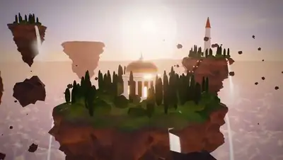</a><br><a href="https://www.sandbase.ai/lab/ai-videos/gpt-6-2-sol/2119437812604838342?lang=zh-CN&utm_source=github&utm_medium=readme&utm_campaign=awesome-gpt-6-2-sol&utm_content=card"><b>从零构建的行星云层与神庙环境</b></a><br><sub><a href="https://x.com/Mr_Salio/status/2119437812604838342">@Mr_Salio</a> · 0:51</sub></td><td width="33%" valign="top"><a href="https://www.sandbase.ai/lab/media/x/gpt-6-2-sol/2122814594737684568/video.mp4">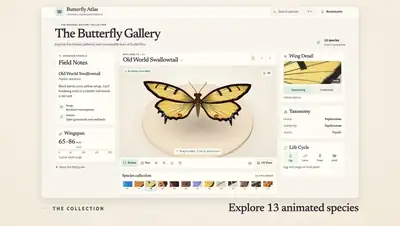</a><br><a href="https://www.sandbase.ai/lab/ai-videos/gpt-6-2-sol/2122814594737684568?lang=zh-CN&utm_source=github&utm_medium=readme&utm_campaign=awesome-gpt-6-2-sol&utm_content=card"><b>使用Blender制作的蝴蝶画廊网站</b></a><br><sub><a href="https://x.com/DeryaTR_/status/2122814594737684568">@DeryaTR_</a></sub></td><td width="33%" valign="top"><a href="https://www.sandbase.ai/lab/media/x/gpt-6-2-sol/2122771021828948464/video.mp4">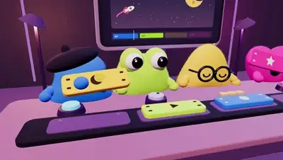</a><br><a href="https://www.sandbase.ai/lab/ai-videos/gpt-6-2-sol/2122771021828948464?lang=zh-CN&utm_source=github&utm_medium=readme&utm_campaign=awesome-gpt-6-2-sol&utm_content=card"><b>纯代码生成的30秒动效设计动画</b></a><br><sub><a href="https://x.com/morsenxxx/status/2122771021828948464">@morsenxxx</a></sub></td></tr>
<tr><td width="33%" valign="top"><a href="https://www.sandbase.ai/lab/media/x/gpt-6-2-sol/2125685812654150021/video.mp4">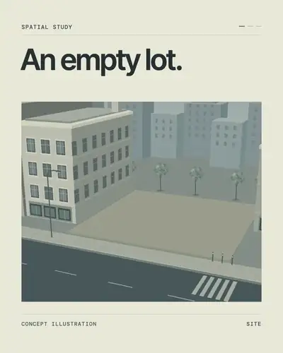</a><br><a href="https://www.sandbase.ai/lab/ai-videos/gpt-6-2-sol/2125685812654150021?lang=zh-CN&utm_source=github&utm_medium=readme&utm_campaign=awesome-gpt-6-2-sol&utm_content=card"><b>XREAL Aura智能眼镜动态设计动画</b></a><br><sub><a href="https://x.com/AmirAnonn/status/2125685812654150021">@AmirAnonn</a></sub></td><td width="33%" valign="top"><a href="https://www.sandbase.ai/lab/media/x/gpt-6-2-sol/2120107337650155798/video.mp4">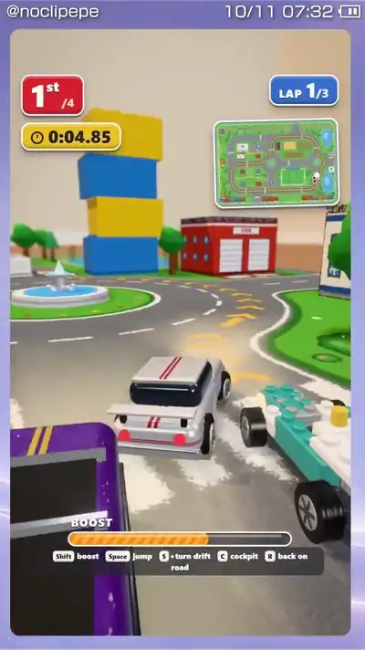</a><br><a href="https://www.sandbase.ai/lab/ai-videos/gpt-6-2-sol/2120107337650155798?lang=zh-CN&utm_source=github&utm_medium=readme&utm_campaign=awesome-gpt-6-2-sol&utm_content=card"><b>将童年地毯制作成可玩赛车游戏</b></a><br><sub><a href="https://x.com/noclipepe/status/2120107337650155798">@noclipepe</a> · 0:55</sub></td><td width="33%" valign="top"><a href="https://www.sandbase.ai/lab/media/x/gpt-6-2-sol/2122760690855264453/video.mp4">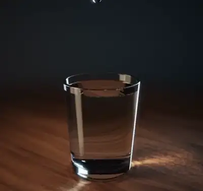</a><br><a href="https://www.sandbase.ai/lab/ai-videos/gpt-6-2-sol/2122760690855264453?lang=zh-CN&utm_source=github&utm_medium=readme&utm_campaign=awesome-gpt-6-2-sol&utm_content=card"><b>水滴慢动作飞溅动画</b></a><br><sub><a href="https://x.com/LDT0545/status/2122760690855264453">@LDT0545</a></sub></td></tr>
<tr><td width="33%" valign="top"><a href="https://www.sandbase.ai/lab/media/x/gpt-6-2-sol/2120490910278418869/video.mp4">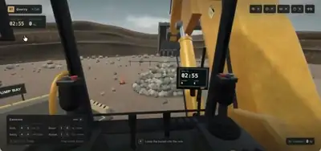</a><br><a href="https://www.sandbase.ai/lab/ai-videos/gpt-6-2-sol/2120490910278418869?lang=zh-CN&utm_source=github&utm_medium=readme&utm_campaign=awesome-gpt-6-2-sol&utm_content=card"><b>可玩的3D挖掘机游戏</b></a><br><sub><a href="https://x.com/Frtnel/status/2120490910278418869">@Frtnel</a> · 0:36</sub></td><td width="33%" valign="top"><a href="https://www.sandbase.ai/lab/media/x/gpt-6-2-sol/2119715462590398839/video.mp4"></a><br><a href="https://www.sandbase.ai/lab/ai-videos/gpt-6-2-sol/2119715462590398839?lang=zh-CN&utm_source=github&utm_medium=readme&utm_campaign=awesome-gpt-6-2-sol&utm_content=card"><b>3D庭院概念发布短片</b></a><br><sub><a href="https://x.com/LeaddeAI/status/2119715462590398839">@LeaddeAI</a> · 0:31</sub></td></tr>
</table>

<a id="3d-scene"></a>

## 3D 场景

<table>
<tr><td width="33%" valign="top"><a href="https://www.sandbase.ai/lab/media/x/gpt-6-2-sol/2119371334878744648/video.mp4"></a><br><a href="https://www.sandbase.ai/lab/ai-videos/gpt-6-2-sol/2119371334878744648?lang=zh-CN&utm_source=github&utm_medium=readme&utm_campaign=awesome-gpt-6-2-sol&utm_content=card"><b>单提示词生成的Three.js 3D场景</b></a><br><sub><a href="https://x.com/TokenGremlin/status/2119371334878744648">@TokenGremlin</a> · 0:05</sub></td><td width="33%" valign="top"><a href="https://www.sandbase.ai/lab/media/x/gpt-6-2-sol/2119395930805879165/video.mp4">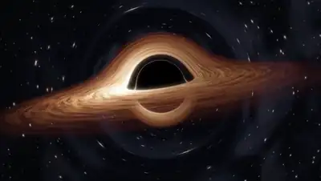</a><br><a href="https://www.sandbase.ai/lab/ai-videos/gpt-6-2-sol/2119395930805879165?lang=zh-CN&utm_source=github&utm_medium=readme&utm_campaign=awesome-gpt-6-2-sol&utm_content=card"><b>用Three.js生成的黑洞场景</b></a><br><sub><a href="https://x.com/TokenGremlin/status/2119395930805879165">@TokenGremlin</a> · 0:06</sub></td><td width="33%" valign="top"><a href="https://www.sandbase.ai/lab/media/x/gpt-6-2-sol/2119407882949288298/video.mp4">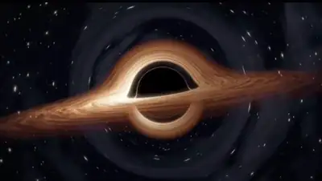</a><br><a href="https://www.sandbase.ai/lab/ai-videos/gpt-6-2-sol/2119407882949288298?lang=zh-CN&utm_source=github&utm_medium=readme&utm_campaign=awesome-gpt-6-2-sol&utm_content=card"><b>Three.js 一次性生成的黑洞视觉模拟</b></a><br><sub><a href="https://x.com/YxzRainy/status/2119407882949288298">@YxzRainy</a> · 0:08</sub></td></tr>
<tr><td width="33%" valign="top"><a href="https://www.sandbase.ai/lab/media/x/gpt-6-2-sol/2119409785900552548/video.mp4">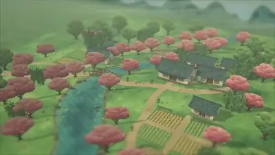</a><br><a href="https://www.sandbase.ai/lab/ai-videos/gpt-6-2-sol/2119409785900552548?lang=zh-CN&utm_source=github&utm_medium=readme&utm_campaign=awesome-gpt-6-2-sol&utm_content=card"><b>Three.js构建的昼夜交替村落</b></a><br><sub><a href="https://x.com/TokenGremlin/status/2119409785900552548">@TokenGremlin</a> · 0:05</sub></td><td width="33%" valign="top"><a href="https://www.sandbase.ai/lab/media/x/gpt-6-2-sol/2119423600692166703/video.mp4">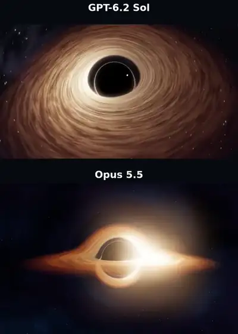</a><br><a href="https://www.sandbase.ai/lab/ai-videos/gpt-6-2-sol/2119423600692166703?lang=zh-CN&utm_source=github&utm_medium=readme&utm_campaign=awesome-gpt-6-2-sol&utm_content=card"><b>Three.js生成的3D创意场景展示</b></a><br><sub><a href="https://x.com/TokenGremlin/status/2119423600692166703">@TokenGremlin</a> · 0:10</sub></td><td width="33%" valign="top"><a href="https://www.sandbase.ai/lab/media/x/gpt-6-2-sol/2119437126194335764/video.mp4"></a><br><a href="https://www.sandbase.ai/lab/ai-videos/gpt-6-2-sol/2119437126194335764?lang=zh-CN&utm_source=github&utm_medium=readme&utm_campaign=awesome-gpt-6-2-sol&utm_content=card"><b>Three.js实时渲染的3D帆船</b></a><br><sub><a href="https://x.com/marcthecreatorr/status/2119437126194335764">@marcthecreatorr</a> · 0:53</sub></td></tr>
</table>

<details>
<summary><b>展开全部 50 条</b></summary>

<table>
<tr><td width="33%" valign="top"><a href="https://www.sandbase.ai/lab/media/x/gpt-6-2-sol/2119437812604838342/video.mp4"></a><br><a href="https://www.sandbase.ai/lab/ai-videos/gpt-6-2-sol/2119437812604838342?lang=zh-CN&utm_source=github&utm_medium=readme&utm_campaign=awesome-gpt-6-2-sol&utm_content=card"><b>从零构建的行星云层与神庙环境</b></a><br><sub><a href="https://x.com/Mr_Salio/status/2119437812604838342">@Mr_Salio</a> · 0:51</sub></td><td width="33%" valign="top"><a href="https://www.sandbase.ai/lab/media/x/gpt-6-2-sol/2119441137576579448/video.mp4">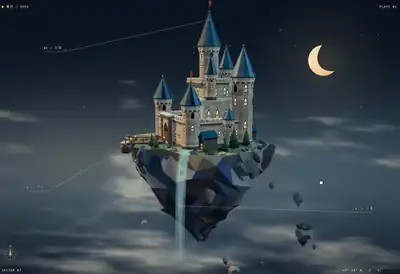</a><br><a href="https://www.sandbase.ai/lab/ai-videos/gpt-6-2-sol/2119441137576579448?lang=zh-CN&utm_source=github&utm_medium=readme&utm_campaign=awesome-gpt-6-2-sol&utm_content=card"><b>Three.js构建的3D浮空城堡</b></a><br><sub><a href="https://x.com/qingzhoucloud/status/2119441137576579448">@qingzhoucloud</a> · 0:22</sub></td><td width="33%" valign="top"><a href="https://www.sandbase.ai/lab/media/x/gpt-6-2-sol/2119445773909926181/video.mp4"></a><br><a href="https://www.sandbase.ai/lab/ai-videos/gpt-6-2-sol/2119445773909926181?lang=zh-CN&utm_source=github&utm_medium=readme&utm_campaign=awesome-gpt-6-2-sol&utm_content=card"><b>Three.js 纯代码生成的 3D 巨浪场景</b></a><br><sub><a href="https://x.com/ai_funss/status/2119445773909926181">@ai_funss</a> · 0:05</sub></td></tr>
<tr><td width="33%" valign="top"><a href="https://www.sandbase.ai/lab/media/x/gpt-6-2-sol/2119464819229344113/video.mp4">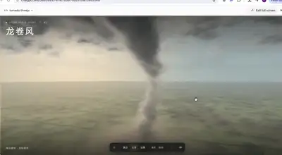</a><br><a href="https://www.sandbase.ai/lab/ai-videos/gpt-6-2-sol/2119464819229344113?lang=zh-CN&utm_source=github&utm_medium=readme&utm_campaign=awesome-gpt-6-2-sol&utm_content=card"><b>Three.js中的可交互逼真龙卷风</b></a><br><sub><a href="https://x.com/Cayden970207/status/2119464819229344113">@Cayden970207</a> · 0:33 · <a href="https://www.sandbase.ai/lab/ai-videos/gpt-6-2-sol/2119464819229344113?lang=zh-CN&utm_source=github&utm_medium=readme&utm_campaign=awesome-gpt-6-2-sol&utm_content=card">提示词</a></sub></td><td width="33%" valign="top"><a href="https://www.sandbase.ai/lab/media/x/gpt-6-2-sol/2119465155109196254/video.mp4">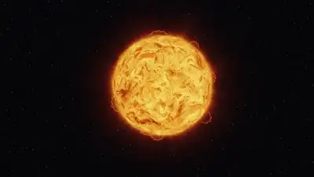</a><br><a href="https://www.sandbase.ai/lab/ai-videos/gpt-6-2-sol/2119465155109196254?lang=zh-CN&utm_source=github&utm_medium=readme&utm_campaign=awesome-gpt-6-2-sol&utm_content=card"><b>电影级3D超新星爆发模拟</b></a><br><sub><a href="https://x.com/pankajkumar_dev/status/2119465155109196254">@pankajkumar_dev</a> · 0:30</sub></td><td width="33%" valign="top"><a href="https://www.sandbase.ai/lab/media/x/gpt-6-2-sol/2119469657291997366/video.mp4">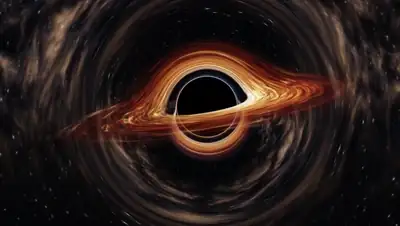</a><br><a href="https://www.sandbase.ai/lab/ai-videos/gpt-6-2-sol/2119469657291997366?lang=zh-CN&utm_source=github&utm_medium=readme&utm_campaign=awesome-gpt-6-2-sol&utm_content=card"><b>带引力透镜效果的3D黑洞模拟</b></a><br><sub><a href="https://x.com/pankajkumar_dev/status/2119469657291997366">@pankajkumar_dev</a> · 0:30</sub></td></tr>
<tr><td width="33%" valign="top"><a href="https://www.sandbase.ai/lab/media/x/gpt-6-2-sol/2119474833738354867/video.mp4">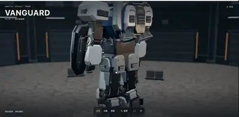</a><br><a href="https://www.sandbase.ai/lab/ai-videos/gpt-6-2-sol/2119474833738354867?lang=zh-CN&utm_source=github&utm_medium=readme&utm_campaign=awesome-gpt-6-2-sol&utm_content=card"><b>单文件 Three.js 运行的 3D 高达模型</b></a><br><sub><a href="https://x.com/Cayden970207/status/2119474833738354867">@Cayden970207</a> · 0:21</sub></td><td width="33%" valign="top"><a href="https://www.sandbase.ai/lab/media/x/gpt-6-2-sol/2119507514459144677/video.mp4"></a><br><a href="https://www.sandbase.ai/lab/ai-videos/gpt-6-2-sol/2119507514459144677?lang=zh-CN&utm_source=github&utm_medium=readme&utm_campaign=awesome-gpt-6-2-sol&utm_content=card"><b>以《时间的尽头》为主题的交互式3D场景</b></a><br><sub><a href="https://x.com/Khazix0918/status/2119507514459144677">@Khazix0918</a> · 0:18 · <a href="https://www.sandbase.ai/lab/ai-videos/gpt-6-2-sol/2119507514459144677?lang=zh-CN&utm_source=github&utm_medium=readme&utm_campaign=awesome-gpt-6-2-sol&utm_content=card">提示词</a></sub></td><td width="33%" valign="top"><a href="https://www.sandbase.ai/lab/media/x/gpt-6-2-sol/2119521331637285138/video.mp4">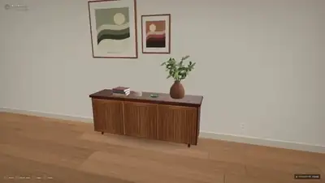</a><br><a href="https://www.sandbase.ai/lab/ai-videos/gpt-6-2-sol/2119521331637285138?lang=zh-CN&utm_source=github&utm_medium=readme&utm_campaign=awesome-gpt-6-2-sol&utm_content=card"><b>GPT-6.2 Sol 渲染的 3D 厨房场景</b></a><br><sub><a href="https://x.com/mirochill/status/2119521331637285138">@mirochill</a> · 0:44</sub></td></tr>
<tr><td width="33%" valign="top"><a href="https://www.sandbase.ai/lab/media/x/gpt-6-2-sol/2119529482776432891/video.mp4">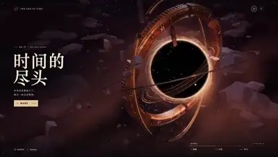</a><br><a href="https://www.sandbase.ai/lab/ai-videos/gpt-6-2-sol/2119529482776432891?lang=zh-CN&utm_source=github&utm_medium=readme&utm_campaign=awesome-gpt-6-2-sol&utm_content=card"><b>时间的尽头3D交互式网页</b></a><br><sub><a href="https://x.com/ThanksuTrump/status/2119529482776432891">@ThanksuTrump</a> · 0:18 · <a href="https://www.sandbase.ai/lab/ai-videos/gpt-6-2-sol/2119529482776432891?lang=zh-CN&utm_source=github&utm_medium=readme&utm_campaign=awesome-gpt-6-2-sol&utm_content=card">提示词</a></sub></td><td width="33%" valign="top"><a href="https://www.sandbase.ai/lab/media/x/gpt-6-2-sol/2119542842393530713/video.mp4">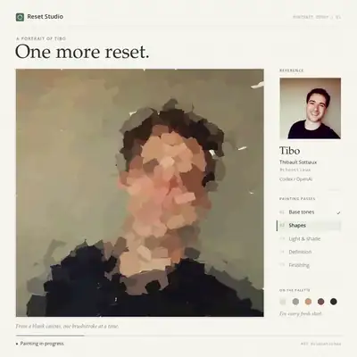</a><br><a href="https://www.sandbase.ai/lab/ai-videos/gpt-6-2-sol/2119542842393530713?lang=zh-CN&utm_source=github&utm_medium=readme&utm_campaign=awesome-gpt-6-2-sol&utm_content=card"><b>GPT-6.2 Sol 渲染的人物肖像</b></a><br><sub><a href="https://x.com/theaidesk_/status/2119542842393530713">@theaidesk_</a> · 0:22</sub></td><td width="33%" valign="top"><a href="https://www.sandbase.ai/lab/media/x/gpt-6-2-sol/2119586200432382100/video.mp4">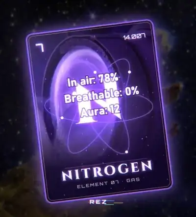</a><br><a href="https://www.sandbase.ai/lab/ai-videos/gpt-6-2-sol/2119586200432382100?lang=zh-CN&utm_source=github&utm_medium=readme&utm_campaign=awesome-gpt-6-2-sol&utm_content=card"><b>使用Opus 5.5制作的水体动画测试</b></a><br><sub><a href="https://x.com/RezAIT00/status/2119586200432382100">@RezAIT00</a> · 0:23</sub></td></tr>
<tr><td width="33%" valign="top"><a href="https://www.sandbase.ai/lab/media/x/gpt-6-2-sol/2119626286373261752/video.mp4"></a><br><a href="https://www.sandbase.ai/lab/ai-videos/gpt-6-2-sol/2119626286373261752?lang=zh-CN&utm_source=github&utm_medium=readme&utm_campaign=awesome-gpt-6-2-sol&utm_content=card"><b>Three.js 生成的长牙紫色毛球</b></a><br><sub><a href="https://x.com/AnikaCodes/status/2119626286373261752">@AnikaCodes</a> · 0:04</sub></td><td width="33%" valign="top"><a href="https://www.sandbase.ai/lab/media/x/gpt-6-2-sol/2119698925255000548/video.mp4">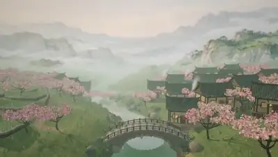</a><br><a href="https://www.sandbase.ai/lab/ai-videos/gpt-6-2-sol/2119698925255000548?lang=zh-CN&utm_source=github&utm_medium=readme&utm_campaign=awesome-gpt-6-2-sol&utm_content=card"><b>Three.js呈现的桃花源记短片</b></a><br><sub><a href="https://x.com/3lhftf/status/2119698925255000548">@3lhftf</a> · 0:36</sub></td><td width="33%" valign="top"><a href="https://www.sandbase.ai/lab/media/x/gpt-6-2-sol/2119700638653468805/video.mp4">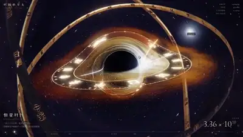</a><br><a href="https://www.sandbase.ai/lab/ai-videos/gpt-6-2-sol/2119700638653468805?lang=zh-CN&utm_source=github&utm_medium=readme&utm_campaign=awesome-gpt-6-2-sol&utm_content=card"><b>Three.js宇宙黑洞时钟</b></a><br><sub><a href="https://x.com/bangbuilds/status/2119700638653468805">@bangbuilds</a> · 2:06</sub></td></tr>
<tr><td width="33%" valign="top"><a href="https://www.sandbase.ai/lab/media/x/gpt-6-2-sol/2119721282170425584/video.mp4">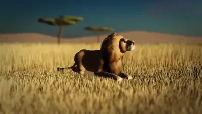</a><br><a href="https://www.sandbase.ai/lab/ai-videos/gpt-6-2-sol/2119721282170425584?lang=zh-CN&utm_source=github&utm_medium=readme&utm_campaign=awesome-gpt-6-2-sol&utm_content=card"><b>基于符号距离场纯代码渲染的3D狮子</b></a><br><sub><a href="https://x.com/Huoimo/status/2119721282170425584">@Huoimo</a> · 0:20</sub></td><td width="33%" valign="top"><a href="https://www.sandbase.ai/lab/media/x/gpt-6-2-sol/2119727194176164167/video.mp4"></a><br><a href="https://www.sandbase.ai/lab/ai-videos/gpt-6-2-sol/2119727194176164167?lang=zh-CN&utm_source=github&utm_medium=readme&utm_campaign=awesome-gpt-6-2-sol&utm_content=card"><b>Three.js《时间的尽头》3D交互网页场景</b></a><br><sub><a href="https://x.com/xiax0603/status/2119727194176164167">@xiax0603</a> · 0:18</sub></td><td width="33%" valign="top"><a href="https://www.sandbase.ai/lab/media/x/gpt-6-2-sol/2119765852618899900/video.mp4"></a><br><a href="https://www.sandbase.ai/lab/ai-videos/gpt-6-2-sol/2119765852618899900?lang=zh-CN&utm_source=github&utm_medium=readme&utm_campaign=awesome-gpt-6-2-sol&utm_content=card"><b>具备昼夜变化的单文件HTML 3D村庄</b></a><br><sub><a href="https://x.com/DawienZZ/status/2119765852618899900">@DawienZZ</a> · 0:05</sub></td></tr>
<tr><td width="33%" valign="top"><a href="https://www.sandbase.ai/lab/media/x/gpt-6-2-sol/2119802691530445058/video.mp4">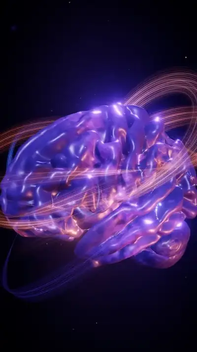</a><br><a href="https://www.sandbase.ai/lab/ai-videos/gpt-6-2-sol/2119802691530445058?lang=zh-CN&utm_source=github&utm_medium=readme&utm_campaign=awesome-gpt-6-2-sol&utm_content=card"><b>3D 大脑与类艾尔登法环视觉测试</b></a><br><sub><a href="https://x.com/Ionkosm/status/2119802691530445058">@Ionkosm</a> · 0:36</sub></td><td width="33%" valign="top"><a href="https://www.sandbase.ai/lab/media/x/gpt-6-2-sol/2119858362318033315/video.mp4">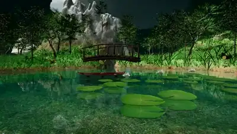</a><br><a href="https://www.sandbase.ai/lab/ai-videos/gpt-6-2-sol/2119858362318033315?lang=zh-CN&utm_source=github&utm_medium=readme&utm_campaign=awesome-gpt-6-2-sol&utm_content=card"><b>Three.js呈现四季更迭的微缩玻璃世界</b></a><br><sub><a href="https://x.com/AnikaCodes/status/2119858362318033315">@AnikaCodes</a> · 0:30</sub></td><td width="33%" valign="top"><a href="https://www.sandbase.ai/lab/media/x/gpt-6-2-sol/2119886504751194537/video.mp4">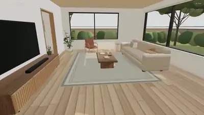</a><br><a href="https://www.sandbase.ai/lab/ai-videos/gpt-6-2-sol/2119886504751194537?lang=zh-CN&utm_source=github&utm_medium=readme&utm_campaign=awesome-gpt-6-2-sol&utm_content=card"><b>GPT-6.2 Sol 生成的交互式 3D 厨房场景</b></a><br><sub><a href="https://x.com/mirochill/status/2119886504751194537">@mirochill</a> · 1:22</sub></td></tr>
<tr><td width="33%" valign="top"><a href="https://www.sandbase.ai/lab/media/x/gpt-6-2-sol/2119921974445064662/video.mp4">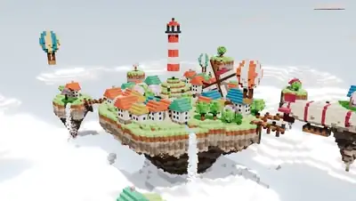</a><br><a href="https://www.sandbase.ai/lab/ai-videos/gpt-6-2-sol/2119921974445064662?lang=zh-CN&utm_source=github&utm_medium=readme&utm_campaign=awesome-gpt-6-2-sol&utm_content=card"><b>纯HTML生成的体素浮岛港口小镇</b></a><br><sub><a href="https://x.com/Synraxyz/status/2119921974445064662">@Synraxyz</a> · 0:12</sub></td><td width="33%" valign="top"><a href="https://www.sandbase.ai/lab/media/x/gpt-6-2-sol/2119984136731738255/video.mp4">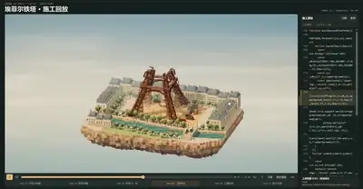</a><br><a href="https://www.sandbase.ai/lab/ai-videos/gpt-6-2-sol/2119984136731738255?lang=zh-CN&utm_source=github&utm_medium=readme&utm_campaign=awesome-gpt-6-2-sol&utm_content=card"><b>Three.js 纯代码生成的体素埃菲尔铁塔施工场景</b></a><br><sub><a href="https://x.com/cfenghub/status/2119984136731738255">@cfenghub</a> · 0:41</sub></td><td width="33%" valign="top"><a href="https://www.sandbase.ai/lab/media/x/gpt-6-2-sol/2119999248594837956/video.mp4">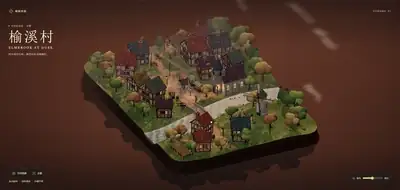</a><br><a href="https://www.sandbase.ai/lab/ai-videos/gpt-6-2-sol/2119999248594837956?lang=zh-CN&utm_source=github&utm_medium=readme&utm_campaign=awesome-gpt-6-2-sol&utm_content=card"><b>夕阳下的可交互3D中世纪村庄沙盘</b></a><br><sub><a href="https://x.com/YFeng2022/status/2119999248594837956">@YFeng2022</a> · 0:40</sub></td></tr>
<tr><td width="33%" valign="top"><a href="https://www.sandbase.ai/lab/media/x/gpt-6-2-sol/2120024150114713936/video.mp4">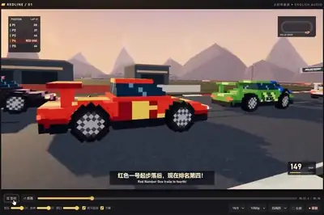</a><br><a href="https://www.sandbase.ai/lab/ai-videos/gpt-6-2-sol/2120024150114713936?lang=zh-CN&utm_source=github&utm_medium=readme&utm_campaign=awesome-gpt-6-2-sol&utm_content=card"><b>Three.js动态体素赛车短片</b></a><br><sub><a href="https://x.com/cfenghub/status/2120024150114713936">@cfenghub</a> · 0:36</sub></td><td width="33%" valign="top"><a href="https://www.sandbase.ai/lab/media/x/gpt-6-2-sol/2120545025893474415/video.mp4"></a><br><a href="https://www.sandbase.ai/lab/ai-videos/gpt-6-2-sol/2120545025893474415?lang=zh-CN&utm_source=github&utm_medium=readme&utm_campaign=awesome-gpt-6-2-sol&utm_content=card"><b>使用Three.js构建的机械蝴蝶</b></a><br><sub><a href="https://x.com/dragono64v/status/2120545025893474415">@dragono64v</a> · 0:26</sub></td><td width="33%" valign="top"><a href="https://www.sandbase.ai/lab/media/x/gpt-6-2-sol/2122391206386925698/video.mp4">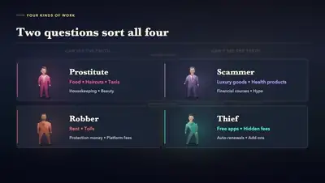</a><br><a href="https://www.sandbase.ai/lab/ai-videos/gpt-6-2-sol/2122391206386925698?lang=zh-CN&utm_source=github&utm_medium=readme&utm_campaign=awesome-gpt-6-2-sol&utm_content=card"><b>使用代码和Python生成的短片作品</b></a><br><sub><a href="https://x.com/yuchenz79260729/status/2122391206386925698">@yuchenz79260729</a> · 1:57</sub></td></tr>
<tr><td width="33%" valign="top"><a href="https://www.sandbase.ai/lab/media/x/gpt-6-2-sol/2122617514454860111/video.mp4"></a><br><a href="https://www.sandbase.ai/lab/ai-videos/gpt-6-2-sol/2122617514454860111?lang=zh-CN&utm_source=github&utm_medium=readme&utm_campaign=awesome-gpt-6-2-sol&utm_content=card"><b>使用Three.js生成的完整3D场景</b></a><br><sub><a href="https://x.com/gadi_neelesh/status/2122617514454860111">@gadi_neelesh</a></sub></td><td width="33%" valign="top"><a href="https://www.sandbase.ai/lab/media/x/gpt-6-2-sol/2122780669973787008/video.mp4"></a><br><a href="https://www.sandbase.ai/lab/ai-videos/gpt-6-2-sol/2122780669973787008?lang=zh-CN&utm_source=github&utm_medium=readme&utm_campaign=awesome-gpt-6-2-sol&utm_content=card"><b>Three.js生成的绿地热气球飞屋场景</b></a><br><sub><a href="https://x.com/TimJayas/status/2122780669973787008">@TimJayas</a></sub></td><td width="33%" valign="top"><a href="https://www.sandbase.ai/lab/media/x/gpt-6-2-sol/2122782073102663874/video.mp4">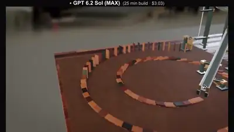</a><br><a href="https://www.sandbase.ai/lab/ai-videos/gpt-6-2-sol/2122782073102663874?lang=zh-CN&utm_source=github&utm_medium=readme&utm_campaign=awesome-gpt-6-2-sol&utm_content=card"><b>HTML代码构建的3D鲁布戈德堡机械模拟</b></a><br><sub><a href="https://x.com/lucian__03/status/2122782073102663874">@lucian__03</a></sub></td></tr>
<tr><td width="33%" valign="top"><a href="https://www.sandbase.ai/lab/media/x/gpt-6-2-sol/2122814594737684568/video.mp4"></a><br><a href="https://www.sandbase.ai/lab/ai-videos/gpt-6-2-sol/2122814594737684568?lang=zh-CN&utm_source=github&utm_medium=readme&utm_campaign=awesome-gpt-6-2-sol&utm_content=card"><b>使用Blender制作的蝴蝶画廊网站</b></a><br><sub><a href="https://x.com/DeryaTR_/status/2122814594737684568">@DeryaTR_</a></sub></td><td width="33%" valign="top"><a href="https://www.sandbase.ai/lab/media/x/gpt-6-2-sol/2122875167156363504/video.mp4">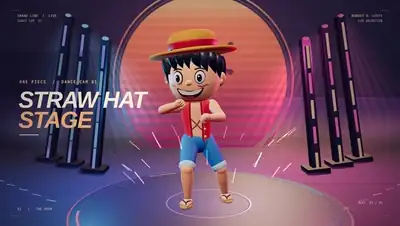</a><br><a href="https://www.sandbase.ai/lab/ai-videos/gpt-6-2-sol/2122875167156363504?lang=zh-CN&utm_source=github&utm_medium=readme&utm_campaign=awesome-gpt-6-2-sol&utm_content=card"><b>路飞在三维场景中跳舞</b></a><br><sub><a href="https://x.com/NeoAIForecast/status/2122875167156363504">@NeoAIForecast</a></sub></td><td width="33%" valign="top"><a href="https://www.sandbase.ai/lab/media/x/gpt-6-2-sol/2122911971091910932/video.mp4">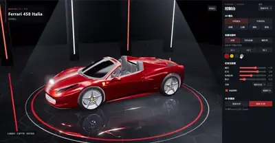</a><br><a href="https://www.sandbase.ai/lab/ai-videos/gpt-6-2-sol/2122911971091910932?lang=zh-CN&utm_source=github&utm_medium=readme&utm_campaign=awesome-gpt-6-2-sol&utm_content=card"><b>可拆解的三维交互式法拉利跑车</b></a><br><sub><a href="https://x.com/cfenghub/status/2122911971091910932">@cfenghub</a></sub></td></tr>
<tr><td width="33%" valign="top"><a href="https://www.sandbase.ai/lab/media/x/gpt-6-2-sol/2122936597700026446/video.mp4">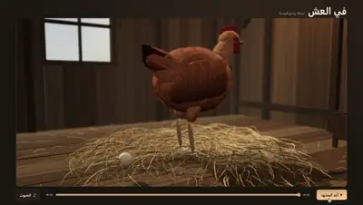</a><br><a href="https://www.sandbase.ai/lab/ai-videos/gpt-6-2-sol/2122936597700026446?lang=zh-CN&utm_source=github&utm_medium=readme&utm_campaign=awesome-gpt-6-2-sol&utm_content=card"><b>GPT-6.2 Sol生成的3D微型鸡舍</b></a><br><sub><a href="https://x.com/Om_Dream1/status/2122936597700026446">@Om_Dream1</a> · 0:17</sub></td><td width="33%" valign="top"><a href="https://www.sandbase.ai/lab/media/x/gpt-6-2-sol/2122978116658217127/video.mp4">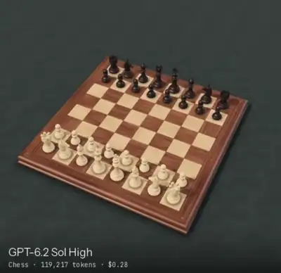</a><br><a href="https://www.sandbase.ai/lab/ai-videos/gpt-6-2-sol/2122978116658217127?lang=zh-CN&utm_source=github&utm_medium=readme&utm_campaign=awesome-gpt-6-2-sol&utm_content=card"><b>GPT-6.2 Sol生成的16个Three.js场景</b></a><br><sub><a href="https://x.com/Frtnel/status/2122978116658217127">@Frtnel</a></sub></td><td width="33%" valign="top"><a href="https://www.sandbase.ai/lab/media/x/gpt-6-2-sol/2123011032692261340/video.mp4">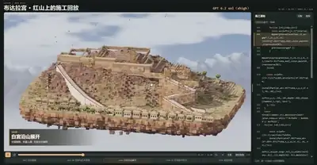</a><br><a href="https://www.sandbase.ai/lab/ai-videos/gpt-6-2-sol/2123011032692261340?lang=zh-CN&utm_source=github&utm_medium=readme&utm_campaign=awesome-gpt-6-2-sol&utm_content=card"><b>Three.js代码直出体素布达拉宫</b></a><br><sub><a href="https://x.com/cfenghub/status/2123011032692261340">@cfenghub</a></sub></td></tr>
<tr><td width="33%" valign="top"><a href="https://www.sandbase.ai/lab/media/x/gpt-6-2-sol/2123249653907075290/video.mp4">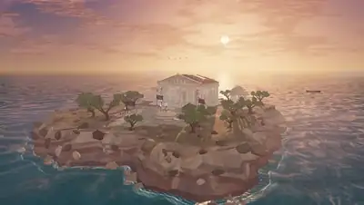</a><br><a href="https://www.sandbase.ai/lab/ai-videos/gpt-6-2-sol/2123249653907075290?lang=zh-CN&utm_source=github&utm_medium=readme&utm_campaign=awesome-gpt-6-2-sol&utm_content=card"><b>Three.js爱琴海岛黄昏场景</b></a><br><sub><a href="https://x.com/Yuziyyaa/status/2123249653907075290">@Yuziyyaa</a></sub></td><td width="33%" valign="top"><a href="https://www.sandbase.ai/lab/media/x/gpt-6-2-sol/2123317934177317320/video.mp4">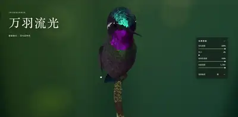</a><br><a href="https://www.sandbase.ai/lab/ai-videos/gpt-6-2-sol/2123317934177317320?lang=zh-CN&utm_source=github&utm_medium=readme&utm_campaign=awesome-gpt-6-2-sol&utm_content=card"><b>使用Three.js构建的万羽蜂鸟</b></a><br><sub><a href="https://x.com/HaileyAILabs/status/2123317934177317320">@HaileyAILabs</a></sub></td><td width="33%" valign="top"><a href="https://www.sandbase.ai/lab/media/x/gpt-6-2-sol/2123677060451463291/video.mp4">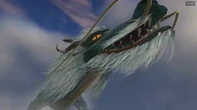</a><br><a href="https://www.sandbase.ai/lab/ai-videos/gpt-6-2-sol/2123677060451463291?lang=zh-CN&utm_source=github&utm_medium=readme&utm_campaign=awesome-gpt-6-2-sol&utm_content=card"><b>Three.js实时渲染的东方巨龙</b></a><br><sub><a href="https://x.com/HaileyAILabs/status/2123677060451463291">@HaileyAILabs</a></sub></td></tr>
<tr><td width="33%" valign="top"><a href="https://www.sandbase.ai/lab/media/x/gpt-6-2-sol/2123779357680488815/video.mp4">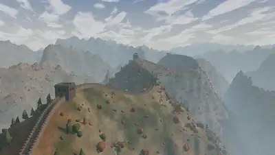</a><br><a href="https://www.sandbase.ai/lab/ai-videos/gpt-6-2-sol/2123779357680488815?lang=zh-CN&utm_source=github&utm_medium=readme&utm_campaign=awesome-gpt-6-2-sol&utm_content=card"><b>使用Three.js生成的长城飞行场景</b></a><br><sub><a href="https://x.com/xiaoanlab/status/2123779357680488815">@xiaoanlab</a></sub></td><td width="33%" valign="top"><a href="https://www.sandbase.ai/lab/media/x/gpt-6-2-sol/2124052516820451501/video.mp4">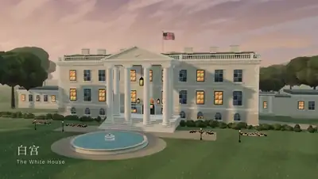</a><br><a href="https://www.sandbase.ai/lab/ai-videos/gpt-6-2-sol/2124052516820451501?lang=zh-CN&utm_source=github&utm_medium=readme&utm_campaign=awesome-gpt-6-2-sol&utm_content=card"><b>使用Three.js生成的白宫拍摄场景</b></a><br><sub><a href="https://x.com/xiaoanlab/status/2124052516820451501">@xiaoanlab</a></sub></td><td width="33%" valign="top"><a href="https://www.sandbase.ai/lab/media/x/gpt-6-2-sol/2124363647589720344/video.mp4">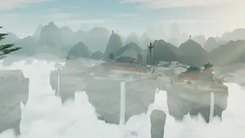</a><br><a href="https://www.sandbase.ai/lab/ai-videos/gpt-6-2-sol/2124363647589720344?lang=zh-CN&utm_source=github&utm_medium=readme&utm_campaign=awesome-gpt-6-2-sol&utm_content=card"><b>Three.js渲染的太虚云门瀑布场景</b></a><br><sub><a href="https://x.com/YFeng2022/status/2124363647589720344">@YFeng2022</a> · <a href="https://www.sandbase.ai/lab/ai-videos/gpt-6-2-sol/2124363647589720344?lang=zh-CN&utm_source=github&utm_medium=readme&utm_campaign=awesome-gpt-6-2-sol&utm_content=card">提示词</a></sub></td></tr>
<tr><td width="33%" valign="top"><a href="https://www.sandbase.ai/lab/media/x/gpt-6-2-sol/2124412588507193799/video.mp4">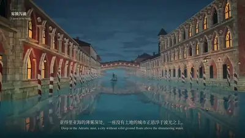</a><br><a href="https://www.sandbase.ai/lab/ai-videos/gpt-6-2-sol/2124412588507193799?lang=zh-CN&utm_source=github&utm_medium=readme&utm_campaign=awesome-gpt-6-2-sol&utm_content=card"><b>威尼斯水城的三维场景可视化</b></a><br><sub><a href="https://x.com/YFeng2022/status/2124412588507193799">@YFeng2022</a> · <a href="https://www.sandbase.ai/lab/ai-videos/gpt-6-2-sol/2124412588507193799?lang=zh-CN&utm_source=github&utm_medium=readme&utm_campaign=awesome-gpt-6-2-sol&utm_content=card">提示词</a></sub></td><td width="33%" valign="top"><a href="https://www.sandbase.ai/lab/media/x/gpt-6-2-sol/2125184446408057169/video.mp4">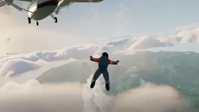</a><br><a href="https://www.sandbase.ai/lab/ai-videos/gpt-6-2-sol/2125184446408057169?lang=zh-CN&utm_source=github&utm_medium=readme&utm_campaign=awesome-gpt-6-2-sol&utm_content=card"><b>Three.js高空极限速度场景</b></a><br><sub><a href="https://x.com/YFeng2022/status/2125184446408057169">@YFeng2022</a> · <a href="https://www.sandbase.ai/lab/ai-videos/gpt-6-2-sol/2125184446408057169?lang=zh-CN&utm_source=github&utm_medium=readme&utm_campaign=awesome-gpt-6-2-sol&utm_content=card">提示词</a></sub></td></tr>
</table>

</details>

<a id="motion-graphics"></a>

## 动效

<table>
<tr><td width="33%" valign="top"><a href="https://www.sandbase.ai/lab/media/x/gpt-6-2-sol/2119454953689473269/video.mp4">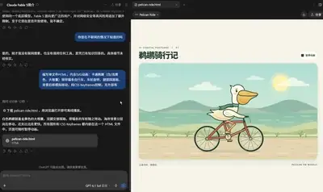</a><br><a href="https://www.sandbase.ai/lab/ai-videos/gpt-6-2-sol/2119454953689473269?lang=zh-CN&utm_source=github&utm_medium=readme&utm_campaign=awesome-gpt-6-2-sol&utm_content=card"><b>卡通鹈鹕骑自行车SVG动画</b></a><br><sub><a href="https://x.com/LJL06019/status/2119454953689473269">@LJL06019</a> · 0:06 · <a href="https://www.sandbase.ai/lab/ai-videos/gpt-6-2-sol/2119454953689473269?lang=zh-CN&utm_source=github&utm_medium=readme&utm_campaign=awesome-gpt-6-2-sol&utm_content=card">提示词</a></sub></td><td width="33%" valign="top"><a href="https://www.sandbase.ai/lab/media/x/gpt-6-2-sol/2119495488445497489/video.mp4">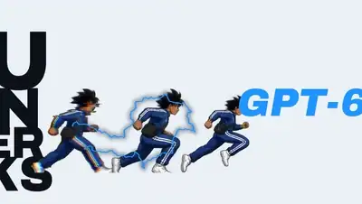</a><br><a href="https://www.sandbase.ai/lab/ai-videos/gpt-6-2-sol/2119495488445497489?lang=zh-CN&utm_source=github&utm_medium=readme&utm_campaign=awesome-gpt-6-2-sol&utm_content=card"><b>代码生成的动作测试包含动画与故障效果</b></a><br><sub><a href="https://x.com/BreezeOg1/status/2119495488445497489">@BreezeOg1</a> · 0:23</sub></td><td width="33%" valign="top"><a href="https://www.sandbase.ai/lab/media/x/gpt-6-2-sol/2119792739546210782/video.mp4"></a><br><a href="https://www.sandbase.ai/lab/ai-videos/gpt-6-2-sol/2119792739546210782?lang=zh-CN&utm_source=github&utm_medium=readme&utm_campaign=awesome-gpt-6-2-sol&utm_content=card"><b>测试GPT-6.2 Sol视频生成动态与画质</b></a><br><sub><a href="https://x.com/KOF97AI/status/2119792739546210782">@KOF97AI</a> · 0:26</sub></td></tr>
<tr><td width="33%" valign="top"><a href="https://www.sandbase.ai/lab/media/x/gpt-6-2-sol/2119796800424997039/video.mp4">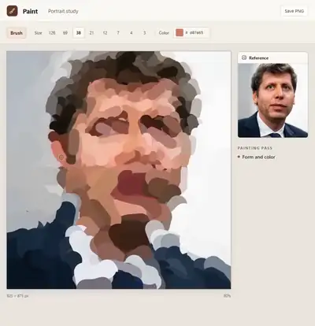</a><br><a href="https://www.sandbase.ai/lab/ai-videos/gpt-6-2-sol/2119796800424997039?lang=zh-CN&utm_source=github&utm_medium=readme&utm_campaign=awesome-gpt-6-2-sol&utm_content=card"><b>笔触绘制山姆·奥特曼肖像画</b></a><br><sub><a href="https://x.com/Apexxxzz/status/2119796800424997039">@Apexxxzz</a> · 0:35</sub></td><td width="33%" valign="top"><a href="https://www.sandbase.ai/lab/media/x/gpt-6-2-sol/2119824977260392635/video.mp4">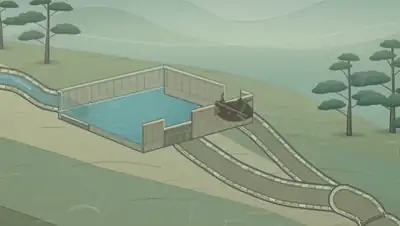</a><br><a href="https://www.sandbase.ai/lab/ai-videos/gpt-6-2-sol/2119824977260392635?lang=zh-CN&utm_source=github&utm_medium=readme&utm_campaign=awesome-gpt-6-2-sol&utm_content=card"><b>测试GPT-6.2 Sol灰度生成效果</b></a><br><sub><a href="https://x.com/GodanLeeX/status/2119824977260392635">@GodanLeeX</a> · 2:37</sub></td><td width="33%" valign="top"><a href="https://www.sandbase.ai/lab/media/x/gpt-6-2-sol/2122771021828948464/video.mp4"></a><br><a href="https://www.sandbase.ai/lab/ai-videos/gpt-6-2-sol/2122771021828948464?lang=zh-CN&utm_source=github&utm_medium=readme&utm_campaign=awesome-gpt-6-2-sol&utm_content=card"><b>纯代码生成的30秒动效设计动画</b></a><br><sub><a href="https://x.com/morsenxxx/status/2122771021828948464">@morsenxxx</a></sub></td></tr>
</table>

<details>
<summary><b>展开全部 9 条</b></summary>

<table>
<tr><td width="33%" valign="top"><a href="https://www.sandbase.ai/lab/media/x/gpt-6-2-sol/2123088360264929712/video.mp4">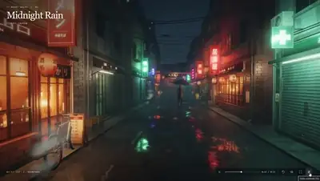</a><br><a href="https://www.sandbase.ai/lab/ai-videos/gpt-6-2-sol/2123088360264929712?lang=zh-CN&utm_source=github&utm_medium=readme&utm_campaign=awesome-gpt-6-2-sol&utm_content=card"><b>GPT-6.2 Sol Ultra同款提示词效果测试</b></a><br><sub><a href="https://x.com/Buildwahab/status/2123088360264929712">@Buildwahab</a> · 0:27</sub></td><td width="33%" valign="top"><a href="https://www.sandbase.ai/lab/media/x/gpt-6-2-sol/2125260680748212357/video.mp4"></a><br><a href="https://www.sandbase.ai/lab/ai-videos/gpt-6-2-sol/2125260680748212357?lang=zh-CN&utm_source=github&utm_medium=readme&utm_campaign=awesome-gpt-6-2-sol&utm_content=card"><b>带有同步画面和字幕的欢快音乐视频</b></a><br><sub><a href="https://x.com/shaunralston/status/2125260680748212357">@shaunralston</a></sub></td><td width="33%" valign="top"><a href="https://www.sandbase.ai/lab/media/x/gpt-6-2-sol/2125685812654150021/video.mp4"></a><br><a href="https://www.sandbase.ai/lab/ai-videos/gpt-6-2-sol/2125685812654150021?lang=zh-CN&utm_source=github&utm_medium=readme&utm_campaign=awesome-gpt-6-2-sol&utm_content=card"><b>XREAL Aura智能眼镜动态设计动画</b></a><br><sub><a href="https://x.com/AmirAnonn/status/2125685812654150021">@AmirAnonn</a></sub></td></tr>
</table>

</details>

<a id="game"></a>

## 游戏

<table>
<tr><td width="33%" valign="top"><a href="https://www.sandbase.ai/lab/media/x/gpt-6-2-sol/2118310499213312478/video.mp4"></a><br><a href="https://www.sandbase.ai/lab/ai-videos/gpt-6-2-sol/2118310499213312478?lang=zh-CN&utm_source=github&utm_medium=readme&utm_campaign=awesome-gpt-6-2-sol&utm_content=card"><b>Three.js制作的3D抓娃娃机游戏</b></a><br><sub><a href="https://x.com/RenaRoze_doll/status/2118310499213312478">@RenaRoze_doll</a> · 0:32</sub></td><td width="33%" valign="top"><a href="https://www.sandbase.ai/lab/media/x/gpt-6-2-sol/2119673965576655211/video.mp4"></a><br><a href="https://www.sandbase.ai/lab/ai-videos/gpt-6-2-sol/2119673965576655211?lang=zh-CN&utm_source=github&utm_medium=readme&utm_campaign=awesome-gpt-6-2-sol&utm_content=card"><b>单提示词生成的太空海盗游戏</b></a><br><sub><a href="https://x.com/Thomas_jorgen/status/2119673965576655211">@Thomas_jorgen</a> · 1:02</sub></td><td width="33%" valign="top"><a href="https://www.sandbase.ai/lab/media/x/gpt-6-2-sol/2119757347291557929/video.mp4"></a><br><a href="https://www.sandbase.ai/lab/ai-videos/gpt-6-2-sol/2119757347291557929?lang=zh-CN&utm_source=github&utm_medium=readme&utm_campaign=awesome-gpt-6-2-sol&utm_content=card"><b>可骑龙飞行的开放式3D世界</b></a><br><sub><a href="https://x.com/0xSynthLab/status/2119757347291557929">@0xSynthLab</a> · 0:45</sub></td></tr>
<tr><td width="33%" valign="top"><a href="https://www.sandbase.ai/lab/media/x/gpt-6-2-sol/2120107337650155798/video.mp4"></a><br><a href="https://www.sandbase.ai/lab/ai-videos/gpt-6-2-sol/2120107337650155798?lang=zh-CN&utm_source=github&utm_medium=readme&utm_campaign=awesome-gpt-6-2-sol&utm_content=card"><b>将童年地毯制作成可玩赛车游戏</b></a><br><sub><a href="https://x.com/noclipepe/status/2120107337650155798">@noclipepe</a> · 0:55</sub></td><td width="33%" valign="top"><a href="https://www.sandbase.ai/lab/media/x/gpt-6-2-sol/2120490910278418869/video.mp4"></a><br><a href="https://www.sandbase.ai/lab/ai-videos/gpt-6-2-sol/2120490910278418869?lang=zh-CN&utm_source=github&utm_medium=readme&utm_campaign=awesome-gpt-6-2-sol&utm_content=card"><b>可玩的3D挖掘机游戏</b></a><br><sub><a href="https://x.com/Frtnel/status/2120490910278418869">@Frtnel</a> · 0:36</sub></td><td width="33%" valign="top"><a href="https://www.sandbase.ai/lab/media/x/gpt-6-2-sol/2122861806767272140/video.mp4"></a><br><a href="https://www.sandbase.ai/lab/ai-videos/gpt-6-2-sol/2122861806767272140?lang=zh-CN&utm_source=github&utm_medium=readme&utm_campaign=awesome-gpt-6-2-sol&utm_content=card"><b>GPT-6.2 Sol单次提示生成的横版卷轴游戏</b></a><br><sub><a href="https://x.com/NeoAIForecast/status/2122861806767272140">@NeoAIForecast</a> · 0:43</sub></td></tr>
</table>

<details>
<summary><b>展开全部 8 条</b></summary>

<table>
<tr><td width="33%" valign="top"><a href="https://www.sandbase.ai/lab/media/x/gpt-6-2-sol/2123149825025708464/video.mp4"></a><br><a href="https://www.sandbase.ai/lab/ai-videos/gpt-6-2-sol/2123149825025708464?lang=zh-CN&utm_source=github&utm_medium=readme&utm_campaign=awesome-gpt-6-2-sol&utm_content=card"><b>三款模型单HTML生成的3D赛车游戏对比</b></a><br><sub><a href="https://x.com/typakon4/status/2123149825025708464">@typakon4</a> · 0:22 · <a href="https://www.sandbase.ai/lab/ai-videos/gpt-6-2-sol/2123149825025708464?lang=zh-CN&utm_source=github&utm_medium=readme&utm_campaign=awesome-gpt-6-2-sol&utm_content=card">提示词</a></sub></td><td width="33%" valign="top"><a href="https://www.sandbase.ai/lab/media/x/gpt-6-2-sol/2124379632283828690/video.mp4"></a><br><a href="https://www.sandbase.ai/lab/ai-videos/gpt-6-2-sol/2124379632283828690?lang=zh-CN&utm_source=github&utm_medium=readme&utm_campaign=awesome-gpt-6-2-sol&utm_content=card"><b>可飞行交互的三维足球游戏</b></a><br><sub><a href="https://x.com/sonuv_dev/status/2124379632283828690">@sonuv_dev</a></sub></td></tr>
</table>

</details>

<a id="particles"></a>

## 粒子与形状

<table>
<tr><td width="33%" valign="top"><a href="https://www.sandbase.ai/lab/media/x/gpt-6-2-sol/2122760690855264453/video.mp4"></a><br><a href="https://www.sandbase.ai/lab/ai-videos/gpt-6-2-sol/2122760690855264453?lang=zh-CN&utm_source=github&utm_medium=readme&utm_campaign=awesome-gpt-6-2-sol&utm_content=card"><b>水滴慢动作飞溅动画</b></a><br><sub><a href="https://x.com/LDT0545/status/2122760690855264453">@LDT0545</a></sub></td></tr>
</table>

<a id="kinetic-type"></a>

## 文字动效

<table>
<tr><td width="33%" valign="top"><a href="https://www.sandbase.ai/lab/media/x/gpt-6-2-sol/2125311635049058355/video.mp4"></a><br><a href="https://www.sandbase.ai/lab/ai-videos/gpt-6-2-sol/2125311635049058355?lang=zh-CN&utm_source=github&utm_medium=readme&utm_campaign=awesome-gpt-6-2-sol&utm_content=card"><b>思念母亲主题歌曲的动态歌词动画</b></a><br><sub><a href="https://x.com/rahul_3rj/status/2125311635049058355">@rahul_3rj</a></sub></td></tr>
</table>

<a id="launch-film"></a>

## 发布片

<table>
<tr><td width="33%" valign="top"><a href="https://www.sandbase.ai/lab/media/x/gpt-6-2-sol/2119715462590398839/video.mp4"></a><br><a href="https://www.sandbase.ai/lab/ai-videos/gpt-6-2-sol/2119715462590398839?lang=zh-CN&utm_source=github&utm_medium=readme&utm_campaign=awesome-gpt-6-2-sol&utm_content=card"><b>3D庭院概念发布短片</b></a><br><sub><a href="https://x.com/LeaddeAI/status/2119715462590398839">@LeaddeAI</a> · 0:31</sub></td></tr>
</table>

<a id="comparison"></a>

## 测试对比

<table>
<tr><td width="33%" valign="top"><a href="https://www.sandbase.ai/lab/media/x/gpt-6-2-sol/2119433734059401260/video.mp4"></a><br><a href="https://www.sandbase.ai/lab/ai-videos/gpt-6-2-sol/2119433734059401260?lang=zh-CN&utm_source=github&utm_medium=readme&utm_campaign=awesome-gpt-6-2-sol&utm_content=card"><b>Codex与API同提示词3D生成效果对比</b></a><br><sub><a href="https://x.com/JustinGorya/status/2119433734059401260">@JustinGorya</a> · 0:07</sub></td><td width="33%" valign="top"><a href="https://www.sandbase.ai/lab/media/x/gpt-6-2-sol/2119469611473358879/video.mp4"></a><br><a href="https://www.sandbase.ai/lab/ai-videos/gpt-6-2-sol/2119469611473358879?lang=zh-CN&utm_source=github&utm_medium=readme&utm_campaign=awesome-gpt-6-2-sol&utm_content=card"><b>GPT-6.2 Sol 渲染的 3D 狮子效果对比</b></a><br><sub><a href="https://x.com/AnikaCodes/status/2119469611473358879">@AnikaCodes</a> · 0:10</sub></td><td width="33%" valign="top"><a href="https://www.sandbase.ai/lab/media/x/gpt-6-2-sol/2119473497504428334/video.mp4"></a><br><a href="https://www.sandbase.ai/lab/ai-videos/gpt-6-2-sol/2119473497504428334?lang=zh-CN&utm_source=github&utm_medium=readme&utm_campaign=awesome-gpt-6-2-sol&utm_content=card"><b>两款模型的SVG动画效果对比</b></a><br><sub><a href="https://x.com/Ananth7e/status/2119473497504428334">@Ananth7e</a> · 2:17</sub></td></tr>
<tr><td width="33%" valign="top"><a href="https://www.sandbase.ai/lab/media/x/gpt-6-2-sol/2119473712751649201/video.mp4"></a><br><a href="https://www.sandbase.ai/lab/ai-videos/gpt-6-2-sol/2119473712751649201?lang=zh-CN&utm_source=github&utm_medium=readme&utm_campaign=awesome-gpt-6-2-sol&utm_content=card"><b>GPT-6.2 Sol与Opus 5.5动画生成效果对比</b></a><br><sub><a href="https://x.com/vikktorrrre/status/2119473712751649201">@vikktorrrre</a> · 0:35</sub></td><td width="33%" valign="top"><a href="https://www.sandbase.ai/lab/media/x/gpt-6-2-sol/2119483038924972047/video.mp4"></a><br><a href="https://www.sandbase.ai/lab/ai-videos/gpt-6-2-sol/2119483038924972047?lang=zh-CN&utm_source=github&utm_medium=readme&utm_campaign=awesome-gpt-6-2-sol&utm_content=card"><b>两款模型生成黑洞场景效果对比</b></a><br><sub><a href="https://x.com/k0dzilla/status/2119483038924972047">@k0dzilla</a> · 0:12</sub></td><td width="33%" valign="top"><a href="https://www.sandbase.ai/lab/media/x/gpt-6-2-sol/2119503807654535300/video.mp4"></a><br><a href="https://www.sandbase.ai/lab/ai-videos/gpt-6-2-sol/2119503807654535300?lang=zh-CN&utm_source=github&utm_medium=readme&utm_campaign=awesome-gpt-6-2-sol&utm_content=card"><b>两款模型生成夜间窗景同提示词对比</b></a><br><sub><a href="https://x.com/theaidesk_/status/2119503807654535300">@theaidesk_</a> · 0:30</sub></td></tr>
</table>

<details>
<summary><b>展开全部 62 条</b></summary>

<table>
<tr><td width="33%" valign="top"><a href="https://www.sandbase.ai/lab/media/x/gpt-6-2-sol/2119516309851361758/video.mp4"></a><br><a href="https://www.sandbase.ai/lab/ai-videos/gpt-6-2-sol/2119516309851361758?lang=zh-CN&utm_source=github&utm_medium=readme&utm_campaign=awesome-gpt-6-2-sol&utm_content=card"><b>相同提示词的模型生成效果测试对比</b></a><br><sub><a href="https://x.com/theaidesk_/status/2119516309851361758">@theaidesk_</a> · 0:43</sub></td><td width="33%" valign="top"><a href="https://www.sandbase.ai/lab/media/x/gpt-6-2-sol/2119728047754547326/video.mp4"></a><br><a href="https://www.sandbase.ai/lab/ai-videos/gpt-6-2-sol/2119728047754547326?lang=zh-CN&utm_source=github&utm_medium=readme&utm_campaign=awesome-gpt-6-2-sol&utm_content=card"><b>两款模型地毯赛车游戏生成效果对比</b></a><br><sub><a href="https://x.com/noclipepe/status/2119728047754547326">@noclipepe</a> · 1:14</sub></td><td width="33%" valign="top"><a href="https://www.sandbase.ai/lab/media/x/gpt-6-2-sol/2119743048364277820/video.mp4"></a><br><a href="https://www.sandbase.ai/lab/ai-videos/gpt-6-2-sol/2119743048364277820?lang=zh-CN&utm_source=github&utm_medium=readme&utm_campaign=awesome-gpt-6-2-sol&utm_content=card"><b>两款模型单文件前端网页审美比拼</b></a><br><sub><a href="https://x.com/Stargridcompass/status/2119743048364277820">@Stargridcompass</a> · 0:16 · <a href="https://www.sandbase.ai/lab/ai-videos/gpt-6-2-sol/2119743048364277820?lang=zh-CN&utm_source=github&utm_medium=readme&utm_campaign=awesome-gpt-6-2-sol&utm_content=card">提示词</a></sub></td></tr>
<tr><td width="33%" valign="top"><a href="https://www.sandbase.ai/lab/media/x/gpt-6-2-sol/2121502334866096160/video.mp4"></a><br><a href="https://www.sandbase.ai/lab/ai-videos/gpt-6-2-sol/2121502334866096160?lang=zh-CN&utm_source=github&utm_medium=readme&utm_campaign=awesome-gpt-6-2-sol&utm_content=card"><b>Three.js 3D海岛任务生成对比</b></a><br><sub><a href="https://x.com/laopai1990/status/2121502334866096160">@laopai1990</a> · 1:06</sub></td><td width="33%" valign="top"><a href="https://www.sandbase.ai/lab/media/x/gpt-6-2-sol/2121532503022514662/video.mp4"></a><br><a href="https://www.sandbase.ai/lab/ai-videos/gpt-6-2-sol/2121532503022514662?lang=zh-CN&utm_source=github&utm_medium=readme&utm_campaign=awesome-gpt-6-2-sol&utm_content=card"><b>三款不同AI模型同提示词效果对比</b></a><br><sub><a href="https://x.com/jayakavuru/status/2121532503022514662">@jayakavuru</a> · 0:43</sub></td><td width="33%" valign="top"><a href="https://www.sandbase.ai/lab/media/x/gpt-6-2-sol/2121555574869360796/video.mp4"></a><br><a href="https://www.sandbase.ai/lab/ai-videos/gpt-6-2-sol/2121555574869360796?lang=zh-CN&utm_source=github&utm_medium=readme&utm_campaign=awesome-gpt-6-2-sol&utm_content=card"><b>三款AI模型同提示词生成对比</b></a><br><sub><a href="https://x.com/realdrovex/status/2121555574869360796">@realdrovex</a> · 0:43</sub></td></tr>
<tr><td width="33%" valign="top"><a href="https://www.sandbase.ai/lab/media/x/gemini-4-hydrogen/2121913603624419568/video.mp4"></a><br><a href="https://www.sandbase.ai/lab/ai-videos/gpt-6-2-sol/2121913603624419568?lang=zh-CN&utm_source=github&utm_medium=readme&utm_campaign=awesome-gpt-6-2-sol&utm_content=card"><b>三个AI模型的横向对比演示</b></a><br><sub><a href="https://x.com/VamsiBuilds/status/2121913603624419568">@VamsiBuilds</a> · 0:43 · <a href="https://www.sandbase.ai/lab/ai-videos/gpt-6-2-sol/2121913603624419568?lang=zh-CN&utm_source=github&utm_medium=readme&utm_campaign=awesome-gpt-6-2-sol&utm_content=card">提示词</a></sub></td><td width="33%" valign="top"><a href="https://www.sandbase.ai/lab/media/x/gemini-4-argon/2122075114883690862/video.mp4"></a><br><a href="https://www.sandbase.ai/lab/ai-videos/gpt-6-2-sol/2122075114883690862?lang=zh-CN&utm_source=github&utm_medium=readme&utm_campaign=awesome-gpt-6-2-sol&utm_content=card"><b>三个AI模型生成地球画面的横向对比</b></a><br><sub><a href="https://x.com/Dain0x/status/2122075114883690862">@Dain0x</a> · 0:43</sub></td><td width="33%" valign="top"><a href="https://www.sandbase.ai/lab/media/x/gpt-6-2-sol/2122322734281830648/video.mp4"></a><br><a href="https://www.sandbase.ai/lab/ai-videos/gpt-6-2-sol/2122322734281830648?lang=zh-CN&utm_source=github&utm_medium=readme&utm_campaign=awesome-gpt-6-2-sol&utm_content=card"><b>鹈鹕雨夜骑车送外卖的AI模型对比</b></a><br><sub><a href="https://x.com/xiax0603/status/2122322734281830648">@xiax0603</a> · 0:20 · <a href="https://www.sandbase.ai/lab/ai-videos/gpt-6-2-sol/2122322734281830648?lang=zh-CN&utm_source=github&utm_medium=readme&utm_campaign=awesome-gpt-6-2-sol&utm_content=card">提示词</a></sub></td></tr>
<tr><td width="33%" valign="top"><a href="https://www.sandbase.ai/lab/media/x/gpt-6-2-astra/2122753176113688601/video.mp4"></a><br><a href="https://www.sandbase.ai/lab/ai-videos/gpt-6-2-sol/2122753176113688601?lang=zh-CN&utm_source=github&utm_medium=readme&utm_campaign=awesome-gpt-6-2-sol&utm_content=card"><b>多款AI模型玩维基百科跳转游戏测速</b></a><br><sub><a href="https://x.com/nickbaumann_/status/2122753176113688601">@nickbaumann_</a></sub></td><td width="33%" valign="top"><a href="https://www.sandbase.ai/lab/media/x/gpt-6-2-sol/2122758425520029886/video.mp4"></a><br><a href="https://www.sandbase.ai/lab/ai-videos/gpt-6-2-sol/2122758425520029886?lang=zh-CN&utm_source=github&utm_medium=readme&utm_campaign=awesome-gpt-6-2-sol&utm_content=card"><b>两代Sol模型3D生成效果对比</b></a><br><sub><a href="https://x.com/LuminaBench/status/2122758425520029886">@LuminaBench</a></sub></td><td width="33%" valign="top"><a href="https://www.sandbase.ai/lab/media/x/gpt-6-2-astra/2122766188933693654/video.mp4"></a><br><a href="https://www.sandbase.ai/lab/ai-videos/gpt-6-2-sol/2122766188933693654?lang=zh-CN&utm_source=github&utm_medium=readme&utm_campaign=awesome-gpt-6-2-sol&utm_content=card"><b>不同模型生成的骑自行车动画SVG鹈鹕</b></a><br><sub><a href="https://x.com/MOPS_PUGS/status/2122766188933693654">@MOPS_PUGS</a> · 0:16</sub></td></tr>
<tr><td width="33%" valign="top"><a href="https://www.sandbase.ai/lab/media/x/gpt-6-2-sol/2122788867694858629/video.mp4"></a><br><a href="https://www.sandbase.ai/lab/ai-videos/gpt-6-2-sol/2122788867694858629?lang=zh-CN&utm_source=github&utm_medium=readme&utm_campaign=awesome-gpt-6-2-sol&utm_content=card"><b>两款模型生成飞机细节与成本对比</b></a><br><sub><a href="https://x.com/EnvolDev/status/2122788867694858629">@EnvolDev</a></sub></td><td width="33%" valign="top"><a href="https://www.sandbase.ai/lab/media/x/gpt-6-2-sol/2122790293095448948/video.mp4"></a><br><a href="https://www.sandbase.ai/lab/ai-videos/gpt-6-2-sol/2122790293095448948?lang=zh-CN&utm_source=github&utm_medium=readme&utm_campaign=awesome-gpt-6-2-sol&utm_content=card"><b>两款模型同提示词3D场景渲染对比</b></a><br><sub><a href="https://x.com/Mr_Salio/status/2122790293095448948">@Mr_Salio</a></sub></td><td width="33%" valign="top"><a href="https://www.sandbase.ai/lab/media/x/gpt-6-2-sol/2122793921239724521/video.mp4"></a><br><a href="https://www.sandbase.ai/lab/ai-videos/gpt-6-2-sol/2122793921239724521?lang=zh-CN&utm_source=github&utm_medium=readme&utm_campaign=awesome-gpt-6-2-sol&utm_content=card"><b>GPT-6.2 Sol 与 Fable 5.2 的 Three.js 生成对比</b></a><br><sub><a href="https://x.com/TimJayas/status/2122793921239724521">@TimJayas</a></sub></td></tr>
<tr><td width="33%" valign="top"><a href="https://www.sandbase.ai/lab/media/x/opus-5-5/2122803967272866254/video.mp4"></a><br><a href="https://www.sandbase.ai/lab/ai-videos/gpt-6-2-sol/2122803967272866254?lang=zh-CN&utm_source=github&utm_medium=readme&utm_campaign=awesome-gpt-6-2-sol&utm_content=card"><b>四款AI模型的飞机渲染效果对比</b></a><br><sub><a href="https://x.com/EnvolDev/status/2122803967272866254">@EnvolDev</a></sub></td><td width="33%" valign="top"><a href="https://www.sandbase.ai/lab/media/x/gpt-6-2-astra/2122822310428279136/video.mp4"></a><br><a href="https://www.sandbase.ai/lab/ai-videos/gpt-6-2-sol/2122822310428279136?lang=zh-CN&utm_source=github&utm_medium=readme&utm_campaign=awesome-gpt-6-2-sol&utm_content=card"><b>Three.js中机甲穿过城市的动画</b></a><br><sub><a href="https://x.com/simonw/status/2122822310428279136">@simonw</a> · <a href="https://www.sandbase.ai/lab/ai-videos/gpt-6-2-sol/2122822310428279136?lang=zh-CN&utm_source=github&utm_medium=readme&utm_campaign=awesome-gpt-6-2-sol&utm_content=card">提示词</a></sub></td><td width="33%" valign="top"><a href="https://www.sandbase.ai/lab/media/x/gpt-6-2-sol/2122825359892623413/video.mp4"></a><br><a href="https://www.sandbase.ai/lab/ai-videos/gpt-6-2-sol/2122825359892623413?lang=zh-CN&utm_source=github&utm_medium=readme&utm_campaign=awesome-gpt-6-2-sol&utm_content=card"><b>植物生长模拟的三维模型对比</b></a><br><sub><a href="https://x.com/Mayuu_France/status/2122825359892623413">@Mayuu_France</a></sub></td></tr>
<tr><td width="33%" valign="top"><a href="https://www.sandbase.ai/lab/media/x/gpt-6-2-sol/2122833050123825445/video.mp4"></a><br><a href="https://www.sandbase.ai/lab/ai-videos/gpt-6-2-sol/2122833050123825445?lang=zh-CN&utm_source=github&utm_medium=readme&utm_campaign=awesome-gpt-6-2-sol&utm_content=card"><b>多模型3D场景生成能力评测对比</b></a><br><sub><a href="https://x.com/NicolaManzini/status/2122833050123825445">@NicolaManzini</a> · 0:27</sub></td><td width="33%" valign="top"><a href="https://www.sandbase.ai/lab/media/x/gpt-6-2-sol/2122842995162763637/video.mp4"></a><br><a href="https://www.sandbase.ai/lab/ai-videos/gpt-6-2-sol/2122842995162763637?lang=zh-CN&utm_source=github&utm_medium=readme&utm_campaign=awesome-gpt-6-2-sol&utm_content=card"><b>Three.js制作的安土桃山时代城下町</b></a><br><sub><a href="https://x.com/takamasa045/status/2122842995162763637">@takamasa045</a></sub></td><td width="33%" valign="top"><a href="https://www.sandbase.ai/lab/media/x/gpt-6-2-astra/2122843995923791990/video.mp4"></a><br><a href="https://www.sandbase.ai/lab/ai-videos/gpt-6-2-sol/2122843995923791990?lang=zh-CN&utm_source=github&utm_medium=readme&utm_campaign=awesome-gpt-6-2-sol&utm_content=card"><b>瓶中体素船模型生成对比</b></a><br><sub><a href="https://x.com/N1njaCodex/status/2122843995923791990">@N1njaCodex</a> · 0:17</sub></td></tr>
<tr><td width="33%" valign="top"><a href="https://www.sandbase.ai/lab/media/x/gpt-6-2-astra/2122885577137598800/video.mp4"></a><br><a href="https://www.sandbase.ai/lab/ai-videos/gpt-6-2-sol/2122885577137598800?lang=zh-CN&utm_source=github&utm_medium=readme&utm_campaign=awesome-gpt-6-2-sol&utm_content=card"><b>可玩虚假广告游戏多模型对比</b></a><br><sub><a href="https://x.com/noclipepe/status/2122885577137598800">@noclipepe</a> · 0:47</sub></td><td width="33%" valign="top"><a href="https://www.sandbase.ai/lab/media/x/gpt-6-2-astra/2122904937655148597/video.mp4"></a><br><a href="https://www.sandbase.ai/lab/ai-videos/gpt-6-2-sol/2122904937655148597?lang=zh-CN&utm_source=github&utm_medium=readme&utm_campaign=awesome-gpt-6-2-sol&utm_content=card"><b>Three.js章鱼动画渲染对比</b></a><br><sub><a href="https://x.com/teddyaisi/status/2122904937655148597">@teddyaisi</a></sub></td><td width="33%" valign="top"><a href="https://www.sandbase.ai/lab/media/x/gemini-4-carbon/2122924848032993560/video.mp4"></a><br><a href="https://www.sandbase.ai/lab/ai-videos/gpt-6-2-sol/2122924848032993560?lang=zh-CN&utm_source=github&utm_medium=readme&utm_campaign=awesome-gpt-6-2-sol&utm_content=card"><b>四款模型渲染黑洞视觉效果对比</b></a><br><sub><a href="https://x.com/Offloop/status/2122924848032993560">@Offloop</a> · 0:12</sub></td></tr>
<tr><td width="33%" valign="top"><a href="https://www.sandbase.ai/lab/media/x/gpt-6-2-sol/2122953325049938227/video.mp4"></a><br><a href="https://www.sandbase.ai/lab/ai-videos/gpt-6-2-sol/2122953325049938227?lang=zh-CN&utm_source=github&utm_medium=readme&utm_campaign=awesome-gpt-6-2-sol&utm_content=card"><b>Three.js中骑自行车的鹈鹕动画</b></a><br><sub><a href="https://x.com/StatsWire/status/2122953325049938227">@StatsWire</a></sub></td><td width="33%" valign="top"><a href="https://www.sandbase.ai/lab/media/x/gpt-6-2-astra/2122956296760528994/video.mp4"></a><br><a href="https://www.sandbase.ai/lab/ai-videos/gpt-6-2-sol/2122956296760528994?lang=zh-CN&utm_source=github&utm_medium=readme&utm_campaign=awesome-gpt-6-2-sol&utm_content=card"><b>红色水上飞机飞越阿尔卑斯高山湖泊</b></a><br><sub><a href="https://x.com/0xKiyoro/status/2122956296760528994">@0xKiyoro</a> · 0:10 · <a href="https://www.sandbase.ai/lab/ai-videos/gpt-6-2-sol/2122956296760528994?lang=zh-CN&utm_source=github&utm_medium=readme&utm_campaign=awesome-gpt-6-2-sol&utm_content=card">提示词</a></sub></td><td width="33%" valign="top"><a href="https://www.sandbase.ai/lab/media/x/gpt-6-2-sol/2122961497748029811/video.mp4"></a><br><a href="https://www.sandbase.ai/lab/ai-videos/gpt-6-2-sol/2122961497748029811?lang=zh-CN&utm_source=github&utm_medium=readme&utm_campaign=awesome-gpt-6-2-sol&utm_content=card"><b>Blender中骑自行车的鹈鹕动画</b></a><br><sub><a href="https://x.com/One2xDatalab/status/2122961497748029811">@One2xDatalab</a> · 0:06</sub></td></tr>
<tr><td width="33%" valign="top"><a href="https://www.sandbase.ai/lab/media/x/gpt-6-2-sol/2122964994463555589/video.mp4"></a><br><a href="https://www.sandbase.ai/lab/ai-videos/gpt-6-2-sol/2122964994463555589?lang=zh-CN&utm_source=github&utm_medium=readme&utm_campaign=awesome-gpt-6-2-sol&utm_content=card"><b>3D白宫场景多模型生成对比</b></a><br><sub><a href="https://x.com/exploraX_/status/2122964994463555589">@exploraX_</a></sub></td><td width="33%" valign="top"><a href="https://www.sandbase.ai/lab/media/x/gpt-6-2-astra/2122982650042597803/video.mp4"></a><br><a href="https://www.sandbase.ai/lab/ai-videos/gpt-6-2-sol/2122982650042597803?lang=zh-CN&utm_source=github&utm_medium=readme&utm_campaign=awesome-gpt-6-2-sol&utm_content=card"><b>慢动作Three.js猎豹奔跑测试对比</b></a><br><sub><a href="https://x.com/teddyaisi/status/2122982650042597803">@teddyaisi</a></sub></td><td width="33%" valign="top"><a href="https://www.sandbase.ai/lab/media/x/gpt-6-2-sol/2122989923729084889/video.mp4"></a><br><a href="https://www.sandbase.ai/lab/ai-videos/gpt-6-2-sol/2122989923729084889?lang=zh-CN&utm_source=github&utm_medium=readme&utm_campaign=awesome-gpt-6-2-sol&utm_content=card"><b>鹈鹕骑车环绕土星环与人物行走动画对比</b></a><br><sub><a href="https://x.com/monkeys_im/status/2122989923729084889">@monkeys_im</a> · 0:18 · <a href="https://www.sandbase.ai/lab/ai-videos/gpt-6-2-sol/2122989923729084889?lang=zh-CN&utm_source=github&utm_medium=readme&utm_campaign=awesome-gpt-6-2-sol&utm_content=card">提示词</a></sub></td></tr>
<tr><td width="33%" valign="top"><a href="https://www.sandbase.ai/lab/media/x/gemini-4-argon/2122989930699792818/video.mp4"></a><br><a href="https://www.sandbase.ai/lab/ai-videos/gpt-6-2-sol/2122989930699792818?lang=zh-CN&utm_source=github&utm_medium=readme&utm_campaign=awesome-gpt-6-2-sol&utm_content=card"><b>具备3D布娃娃物理效果的恐龙游戏</b></a><br><sub><a href="https://x.com/noclipepe/status/2122989930699792818">@noclipepe</a> · 0:32</sub></td><td width="33%" valign="top"><a href="https://www.sandbase.ai/lab/media/x/gpt-6-2-sol/2123016564911821245/video.mp4"></a><br><a href="https://www.sandbase.ai/lab/ai-videos/gpt-6-2-sol/2123016564911821245?lang=zh-CN&utm_source=github&utm_medium=readme&utm_campaign=awesome-gpt-6-2-sol&utm_content=card"><b>西部火车基准测试多模型对比</b></a><br><sub><a href="https://x.com/mewset/status/2123016564911821245">@mewset</a> · 0:47</sub></td><td width="33%" valign="top"><a href="https://www.sandbase.ai/lab/media/x/gpt-6-2-sol/2123029221857456568/video.mp4"></a><br><a href="https://www.sandbase.ai/lab/ai-videos/gpt-6-2-sol/2123029221857456568?lang=zh-CN&utm_source=github&utm_medium=readme&utm_campaign=awesome-gpt-6-2-sol&utm_content=card"><b>四款模型飞机生成效果与成本对比</b></a><br><sub><a href="https://x.com/notlikeryo_/status/2123029221857456568">@notlikeryo_</a> · 0:25</sub></td></tr>
<tr><td width="33%" valign="top"><a href="https://www.sandbase.ai/lab/media/x/gpt-6-2-astra/2123030965777821985/video.mp4"></a><br><a href="https://www.sandbase.ai/lab/ai-videos/gpt-6-2-sol/2123030965777821985?lang=zh-CN&utm_source=github&utm_medium=readme&utm_campaign=awesome-gpt-6-2-sol&utm_content=card"><b>Three.js中科幻机甲组装升空动画</b></a><br><sub><a href="https://x.com/alohaproxy/status/2123030965777821985">@alohaproxy</a> · <a href="https://www.sandbase.ai/lab/ai-videos/gpt-6-2-sol/2123030965777821985?lang=zh-CN&utm_source=github&utm_medium=readme&utm_campaign=awesome-gpt-6-2-sol&utm_content=card">提示词</a></sub></td><td width="33%" valign="top"><a href="https://www.sandbase.ai/lab/media/x/gpt-6-2-sol/2123051683584360888/video.mp4"></a><br><a href="https://www.sandbase.ai/lab/ai-videos/gpt-6-2-sol/2123051683584360888?lang=zh-CN&utm_source=github&utm_medium=readme&utm_campaign=awesome-gpt-6-2-sol&utm_content=card"><b>同一提示词下的多模型效果对比</b></a><br><sub><a href="https://x.com/aiwithadb/status/2123051683584360888">@aiwithadb</a> · 0:15</sub></td><td width="33%" valign="top"><a href="https://www.sandbase.ai/lab/media/x/gemini-4-argon/2123060685647261951/video.mp4"></a><br><a href="https://www.sandbase.ai/lab/ai-videos/gpt-6-2-sol/2123060685647261951?lang=zh-CN&utm_source=github&utm_medium=readme&utm_campaign=awesome-gpt-6-2-sol&utm_content=card"><b>具有物理碰撞效果的3D恐龙游戏</b></a><br><sub><a href="https://x.com/jonson_coder/status/2123060685647261951">@jonson_coder</a></sub></td></tr>
<tr><td width="33%" valign="top"><a href="https://www.sandbase.ai/lab/media/x/gpt-6-2-sol/2123061055677137354/video.mp4"></a><br><a href="https://www.sandbase.ai/lab/ai-videos/gpt-6-2-sol/2123061055677137354?lang=zh-CN&utm_source=github&utm_medium=readme&utm_campaign=awesome-gpt-6-2-sol&utm_content=card"><b>循环行走动作多模型生成对比</b></a><br><sub><a href="https://x.com/monkeys_im/status/2123061055677137354">@monkeys_im</a> · 0:20 · <a href="https://www.sandbase.ai/lab/ai-videos/gpt-6-2-sol/2123061055677137354?lang=zh-CN&utm_source=github&utm_medium=readme&utm_campaign=awesome-gpt-6-2-sol&utm_content=card">提示词</a></sub></td><td width="33%" valign="top"><a href="https://www.sandbase.ai/lab/media/x/gpt-6-2-astra/2123070036348727301/video.mp4"></a><br><a href="https://www.sandbase.ai/lab/ai-videos/gpt-6-2-sol/2123070036348727301?lang=zh-CN&utm_source=github&utm_medium=readme&utm_campaign=awesome-gpt-6-2-sol&utm_content=card"><b>Three.js巨浪袭击海上钻井平台模型对比</b></a><br><sub><a href="https://x.com/teddyaisi/status/2123070036348727301">@teddyaisi</a></sub></td><td width="33%" valign="top"><a href="https://www.sandbase.ai/lab/media/x/gpt-6-2-sol/2123082351311761553/video.mp4"></a><br><a href="https://www.sandbase.ai/lab/ai-videos/gpt-6-2-sol/2123082351311761553?lang=zh-CN&utm_source=github&utm_medium=readme&utm_campaign=awesome-gpt-6-2-sol&utm_content=card"><b>三款模型生成飞机场景渲染效果对比</b></a><br><sub><a href="https://x.com/m1lad_az/status/2123082351311761553">@m1lad_az</a> · 0:25</sub></td></tr>
<tr><td width="33%" valign="top"><a href="https://www.sandbase.ai/lab/media/x/gemini-4-carbon/2123164032882659819/video.mp4"></a><br><a href="https://www.sandbase.ai/lab/ai-videos/gpt-6-2-sol/2123245309983961285?lang=zh-CN&utm_source=github&utm_medium=readme&utm_campaign=awesome-gpt-6-2-sol&utm_content=card"><b>多个AI模型的Three.js基准测试对比</b></a><br><sub><a href="https://x.com/mylesBaiM/status/2123245309983961285">@mylesBaiM</a></sub></td><td width="33%" valign="top"><a href="https://www.sandbase.ai/lab/media/x/gpt-6-2-sol/2123368723872391279/video.mp4"></a><br><a href="https://www.sandbase.ai/lab/ai-videos/gpt-6-2-sol/2123368723872391279?lang=zh-CN&utm_source=github&utm_medium=readme&utm_campaign=awesome-gpt-6-2-sol&utm_content=card"><b>对比不同模型生成城市建筑的渲染效果</b></a><br><sub><a href="https://x.com/Foomingli/status/2123368723872391279">@Foomingli</a> · <a href="https://www.sandbase.ai/lab/ai-videos/gpt-6-2-sol/2123368723872391279?lang=zh-CN&utm_source=github&utm_medium=readme&utm_campaign=awesome-gpt-6-2-sol&utm_content=card">提示词</a></sub></td><td width="33%" valign="top"><a href="https://www.sandbase.ai/lab/media/x/gpt-6-2-sol/2123403192604164531/video.mp4"></a><br><a href="https://www.sandbase.ai/lab/ai-videos/gpt-6-2-sol/2123403192604164531?lang=zh-CN&utm_source=github&utm_medium=readme&utm_campaign=awesome-gpt-6-2-sol&utm_content=card"><b>钢铁侠Three.js场景生成对比</b></a><br><sub><a href="https://x.com/Quaxguy/status/2123403192604164531">@Quaxguy</a></sub></td></tr>
<tr><td width="33%" valign="top"><a href="https://www.sandbase.ai/lab/media/x/gpt-6-2-sol/2123423017015652426/video.mp4"></a><br><a href="https://www.sandbase.ai/lab/ai-videos/gpt-6-2-sol/2123423017015652426?lang=zh-CN&utm_source=github&utm_medium=readme&utm_campaign=awesome-gpt-6-2-sol&utm_content=card"><b>三个模型构建哈利法塔环绕场景对比</b></a><br><sub><a href="https://x.com/teddyaisi/status/2123423017015652426">@teddyaisi</a></sub></td><td width="33%" valign="top"><a href="https://www.sandbase.ai/lab/media/x/gpt-6-2-sol/2123467647069151691/video.mp4"></a><br><a href="https://www.sandbase.ai/lab/ai-videos/gpt-6-2-sol/2123467647069151691?lang=zh-CN&utm_source=github&utm_medium=readme&utm_campaign=awesome-gpt-6-2-sol&utm_content=card"><b>骑行鹈鹕三维模型的模型对比</b></a><br><sub><a href="https://x.com/YFarmX/status/2123467647069151691">@YFarmX</a> · <a href="https://www.sandbase.ai/lab/ai-videos/gpt-6-2-sol/2123467647069151691?lang=zh-CN&utm_source=github&utm_medium=readme&utm_campaign=awesome-gpt-6-2-sol&utm_content=card">提示词</a></sub></td><td width="33%" valign="top"><a href="https://www.sandbase.ai/lab/media/x/gpt-6-2-sol/2124132383456997820/video.mp4"></a><br><a href="https://www.sandbase.ai/lab/ai-videos/gpt-6-2-sol/2124132383456997820?lang=zh-CN&utm_source=github&utm_medium=readme&utm_campaign=awesome-gpt-6-2-sol&utm_content=card"><b>三个 AI 模型的三维海滨城市对比</b></a><br><sub><a href="https://x.com/srikanthvaluri/status/2124132383456997820">@srikanthvaluri</a></sub></td></tr>
<tr><td width="33%" valign="top"><a href="https://www.sandbase.ai/lab/media/x/gpt-6-2-astra/2124203254011854973/video.mp4"></a><br><a href="https://www.sandbase.ai/lab/ai-videos/gpt-6-2-sol/2124203254011854973?lang=zh-CN&utm_source=github&utm_medium=readme&utm_campaign=awesome-gpt-6-2-sol&utm_content=card"><b>四种AI模型构建埃菲尔铁塔对比</b></a><br><sub><a href="https://x.com/Bhavani_00007/status/2124203254011854973">@Bhavani_00007</a></sub></td><td width="33%" valign="top"><a href="https://www.sandbase.ai/lab/media/x/gpt-6-2-sol/2124327691705012445/video.mp4"></a><br><a href="https://www.sandbase.ai/lab/ai-videos/gpt-6-2-sol/2124327691705012445?lang=zh-CN&utm_source=github&utm_medium=readme&utm_campaign=awesome-gpt-6-2-sol&utm_content=card"><b>Three.js网页生成模型对比</b></a><br><sub><a href="https://x.com/vipinxtwt/status/2124327691705012445">@vipinxtwt</a></sub></td><td width="33%" valign="top"><a href="https://www.sandbase.ai/lab/media/x/gpt-6-2-sol/2124760284338221241/video.mp4"></a><br><a href="https://www.sandbase.ai/lab/ai-videos/gpt-6-2-sol/2124760284338221241?lang=zh-CN&utm_source=github&utm_medium=readme&utm_campaign=awesome-gpt-6-2-sol&utm_content=card"><b>两款模型生成的动态网页对比</b></a><br><sub><a href="https://x.com/exploraX_/status/2124760284338221241">@exploraX_</a></sub></td></tr>
<tr><td width="33%" valign="top"><a href="https://www.sandbase.ai/lab/media/x/gpt-6-2-sol/2124996079469089039/video.mp4"></a><br><a href="https://www.sandbase.ai/lab/ai-videos/gpt-6-2-sol/2124996079469089039?lang=zh-CN&utm_source=github&utm_medium=readme&utm_campaign=awesome-gpt-6-2-sol&utm_content=card"><b>两个AI模型的火箭发射动画对比</b></a><br><sub><a href="https://x.com/remoteugur/status/2124996079469089039">@remoteugur</a></sub></td><td width="33%" valign="top"><a href="https://www.sandbase.ai/lab/media/x/gpt-6-2-sol/2125239497986134399/video.mp4"></a><br><a href="https://www.sandbase.ai/lab/ai-videos/gpt-6-2-sol/2125239497986134399?lang=zh-CN&utm_source=github&utm_medium=readme&utm_campaign=awesome-gpt-6-2-sol&utm_content=card"><b>两个AI模型的简单HTML对比</b></a><br><sub><a href="https://x.com/Sergimcc/status/2125239497986134399">@Sergimcc</a></sub></td><td width="33%" valign="top"><a href="https://www.sandbase.ai/lab/media/x/gpt-6-2-sol/2125270367187169782/video.mp4"></a><br><a href="https://www.sandbase.ai/lab/ai-videos/gpt-6-2-sol/2125270367187169782?lang=zh-CN&utm_source=github&utm_medium=readme&utm_campaign=awesome-gpt-6-2-sol&utm_content=card"><b>四个模型生成翡翠波浪场景对比</b></a><br><sub><a href="https://x.com/EnvolDev/status/2125270367187169782">@EnvolDev</a> · <a href="https://www.sandbase.ai/lab/ai-videos/gpt-6-2-sol/2125270367187169782?lang=zh-CN&utm_source=github&utm_medium=readme&utm_campaign=awesome-gpt-6-2-sol&utm_content=card">提示词</a></sub></td></tr>
<tr><td width="33%" valign="top"><a href="https://www.sandbase.ai/lab/media/x/gpt-6-2-sol/2125273241669280085/video.mp4"></a><br><a href="https://www.sandbase.ai/lab/ai-videos/gpt-6-2-sol/2125273241669280085?lang=zh-CN&utm_source=github&utm_medium=readme&utm_campaign=awesome-gpt-6-2-sol&utm_content=card"><b>纯代码构建网页鼓机与低音合成器</b></a><br><sub><a href="https://x.com/Strongin_/status/2125273241669280085">@Strongin_</a></sub></td><td width="33%" valign="top"><a href="https://www.sandbase.ai/lab/media/x/gpt-6-2-sol/2125433795553767714/video.mp4"></a><br><a href="https://www.sandbase.ai/lab/ai-videos/gpt-6-2-sol/2125433795553767714?lang=zh-CN&utm_source=github&utm_medium=readme&utm_campaign=awesome-gpt-6-2-sol&utm_content=card"><b>四款模型制作3D四叶草动画的对比测试</b></a><br><sub><a href="https://x.com/ALwith_ai/status/2125433795553767714">@ALwith_ai</a></sub></td><td width="33%" valign="top"><a href="https://www.sandbase.ai/lab/media/x/gpt-6-2-sol/2125577373525406135/video.mp4"></a><br><a href="https://www.sandbase.ai/lab/ai-videos/gpt-6-2-sol/2125577373525406135?lang=zh-CN&utm_source=github&utm_medium=readme&utm_campaign=awesome-gpt-6-2-sol&utm_content=card"><b>三款模型复现星际穿越黑洞效果对比</b></a><br><sub><a href="https://x.com/0xClaudAI/status/2125577373525406135">@0xClaudAI</a></sub></td></tr>
<tr><td width="33%" valign="top"><a href="https://www.sandbase.ai/lab/media/x/gpt-6-2-sol/2125635835580289415/video.mp4"></a><br><a href="https://www.sandbase.ai/lab/ai-videos/gpt-6-2-sol/2125633183161139699?lang=zh-CN&utm_source=github&utm_medium=readme&utm_campaign=awesome-gpt-6-2-sol&utm_content=card"><b>四款模型在Winter Crown提示词下的生成对比</b></a><br><sub><a href="https://x.com/EnvolDev/status/2125633183161139699">@EnvolDev</a></sub></td><td width="33%" valign="top"><a href="https://www.sandbase.ai/lab/media/x/gpt-6-2-sol/2125695099099025428/video.mp4"></a><br><a href="https://www.sandbase.ai/lab/ai-videos/gpt-6-2-sol/2125695099099025428?lang=zh-CN&utm_source=github&utm_medium=readme&utm_campaign=awesome-gpt-6-2-sol&utm_content=card"><b>代码智能体凭证安全陷阱测试</b></a><br><sub><a href="https://x.com/stas_sorokin_/status/2125695099099025428">@stas_sorokin_</a> · <a href="https://www.sandbase.ai/lab/ai-videos/gpt-6-2-sol/2125695099099025428?lang=zh-CN&utm_source=github&utm_medium=readme&utm_campaign=awesome-gpt-6-2-sol&utm_content=card">提示词</a></sub></td></tr>
</table>

</details>

**[在 SandBase Lab 查看全部 132 条 →](https://www.sandbase.ai/lab/ai-videos/gpt-6-2-sol?lang=zh-CN&utm_source=github&utm_medium=readme&utm_campaign=awesome-gpt-6-2-sol&utm_content=section)**

<a id="recreate"></a>

## 用 GPT-6.2 Sol 复刻视频

[SandBase Lab](https://www.sandbase.ai/lab/ai-videos/gpt-6-2-sol?lang=zh-CN&utm_source=github&utm_medium=readme&utm_campaign=awesome-gpt-6-2-sol&utm_content=recreate) 的每个视频页都有 **复刻** 按钮：在 Lab 文本竞技场把帖子内容发给 GPT-6.2 Sol，返回可在浏览器直接播放的代码。

用 API 的话，GPT-6.2 Sol 在 SandBase 上的模型 ID 是 `openai/gpt-6.2-sol`（兼容 OpenAI）。把提示词写进 `prompt.txt`，在 [控制台](https://www.sandbase.ai/console/keys?utm_source=github&utm_medium=readme&utm_campaign=awesome-gpt-6-2-sol) 创建 Key，然后运行：

```bash
jq -n --rawfile prompt prompt.txt \
  '{model: "openai/gpt-6.2-sol", max_tokens: 128000, messages: [{role: "user", content: $prompt}]}' |
curl -sS --max-time 900 https://api.sandbase.ai/v1/chat/completions \
  -H "Authorization: Bearer $SANDBASE_API_KEY" \
  -H "Content-Type: application/json" \
  -d @- | jq -r '.choices[0].message.content' | sed '/^```/d' > gpt-6-2-sol.html
```

用浏览器打开 `gpt-6-2-sol.html`，或在 [SandBox](https://www.sandbase.ai/landing/sandbox?utm_source=github&utm_medium=readme&utm_campaign=awesome-gpt-6-2-sol) 中运行，让生成的代码保持隔离。上面的示例把 `max_tokens` 设为 128000，给长页面留出空间。完整步骤见 [教程](docs/zh-CN/tutorial.md)，价格见 [模型页](https://www.sandbase.ai/model/openai/gpt-6.2-sol?utm_source=github&utm_medium=readme&utm_campaign=awesome-gpt-6-2-sol)。

<a id="faq"></a>

## 常见问题

### GPT-6.2 Sol 是什么？

GPT-6.2 Sol 是 OpenAI GPT-6.2 系列的模型，2026 年 11 月 8 日宣布，在 SandBase 上的模型 ID 是 `openai/gpt-6.2-sol`。发布初期有创作者报告它在前端和 3D 设计上的明显提升。来源：Lab 合集记录，以及 `sandbase inspect openai/gpt-6.2-sol`。

### 这些 GPT-6.2 Sol 视频是怎么做出来的？

模型并不直接渲染视频。它写出一个网页，3D 场景通常用 Three.js，作者再把页面播放过程录下来。本列表里的作者分别发了一次生成的需求、一句话需求的交互式 Three.js 场景，以及同提示词对比。见 [教程](docs/zh-CN/tutorial.md)。

### 在哪里找到视频的提示词？

标有 **提示词** 的视频，其 Lab 页面上有作者的提示词。[提示词索引](docs/zh-CN/prompts.md) 列出了全部。

### 怎么写好 GPT-6.2 Sol 提示词？

指定输出一个独立的 HTML 文件，并说明用哪个渲染方式（例如 Three.js）；描述场景和想要的交互，并要求交付完成、可直接运行的成品。详细写法和模板见 [提示词写法](docs/zh-CN/prompt-guide.md)。

### 怎么调用 GPT-6.2 Sol API？

在 SandBase 上模型 ID 是 `openai/gpt-6.2-sol`，使用兼容 OpenAI 的 `/v1/chat/completions` 接口，一个 Key 调用所有模型。见 [复刻](#recreate) 和 [模型页](https://www.sandbase.ai/model/openai/gpt-6.2-sol?utm_source=github&utm_medium=readme&utm_campaign=awesome-gpt-6-2-sol)。

### GPT-6.2 Sol 比 Claude Opus 5.5 更强吗？

目前没有实测结论：本列表编写时，Lab [Evals 榜单](https://www.sandbase.ai/leaderboards?lang=zh-CN&utm_source=github&utm_medium=readme&utm_campaign=awesome-gpt-6-2-sol) 和 [Pelican Test](https://www.sandbase.ai/arena/pelican-test?lang=zh-CN&utm_source=github&utm_medium=readme&utm_campaign=awesome-gpt-6-2-sol) 上都还没有 GPT-6.2 Sol 的结果。有创作者把同一个前端提示词分别交给 GPT-6.2 Sol 和 Claude Opus 5.5，报告 GPT-6.2 Sol 的前端设计有明显提升，并请观众自行判断。详见 [模型对比](docs/zh-CN/model-comparison.md)。

### 做一个视频要花多少钱？

本列表的创作者帖子没有给出花费，所以这里不给数字。标价见 [模型页](https://www.sandbase.ai/model/openai/gpt-6.2-sol?utm_source=github&utm_medium=readme&utm_campaign=awesome-gpt-6-2-sol)。

### 可以转用这些视频吗？

默认不可以，视频归作者所有。见 [MEDIA-RIGHTS](MEDIA-RIGHTS.md)。

<a id="contribute"></a>

## 推荐作品

发现了应该收录的 GPT-6.2 Sol 作品？附上 X 原帖 [提交给我们](https://github.com/sandbase-lab/awesome-gpt-6-2-sol/issues/new?template=submit-video.yml)。通过后会先加入 SandBase Lab，下一次每日同步时出现在这里。觉得有用的话，点个 ⭐ 能让更多人看到。

## 致谢与权利

所有视频、提示词和帖子归作者所有。每张卡片都注明作者并链接原帖。MIT 许可证只覆盖本仓库的脚本。更正署名或下架视频请见 [MEDIA-RIGHTS](MEDIA-RIGHTS.md)。

与 OpenAI 无隶属或背书关系。

---

由 [SandBase Lab](https://www.sandbase.ai/lab/?lang=zh-CN&utm_source=github&utm_medium=readme&utm_campaign=awesome-gpt-6-2-sol) 维护 · [全部 AI 视频合集](https://www.sandbase.ai/lab/ai-videos?lang=zh-CN&utm_source=github&utm_medium=readme&utm_campaign=awesome-gpt-6-2-sol)
